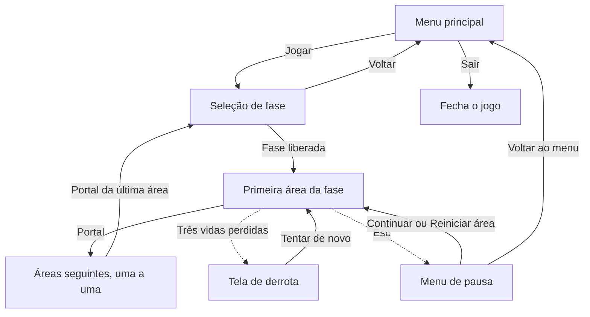

# Documentação — Ascensão ao Olimpo

Tudo o que já está implementado no projeto, sistema por sistema: o que cada script faz, como as cenas são montadas e como usar cada peça para construir as fases.

Situação em 11/10/2026. O [README.md](README.md) explica a organização do repositório e o fluxo de trabalho; o [CHECK.md](CHECK.md) lista as tarefas e a ordem delas. Este arquivo explica o código. A pasta do grupo no Google Drive, onde ficam os arquivos de trabalho, está descrita na seção 12 do README.

## Sumário

1. [O que já existe](#1-o-que-já-existe)
2. [Como rodar e testar](#2-como-rodar-e-testar)
3. [Fluxo do jogo](#3-fluxo-do-jogo)
4. [Configuração do projeto](#4-configuração-do-projeto)
5. [Mapa dos arquivos](#5-mapa-dos-arquivos)
6. [Personagem](#6-personagem)
7. [Dano e vida](#7-dano-e-vida)
8. [Ataque](#8-ataque)
9. [Esquiva](#9-esquiva)
10. [Checkpoint, queda e reaparecimento](#10-checkpoint-queda-e-reaparecimento)
11. [Interação com objetos](#11-interação-com-objetos)
12. [Puzzle de luz de Afrodite](#12-puzzle-de-luz-de-afrodite)
13. [Acionadores, porta e saída condicionada](#13-acionadores-porta-e-saída-condicionada)
14. [Áreas e câmera](#14-áreas-e-câmera)
15. [Portal e conclusão de área](#15-portal-e-conclusão-de-área)
16. [Progresso e salvamento](#16-progresso-e-salvamento)
17. [Transição entre cenas](#17-transição-entre-cenas)
18. [Interface](#18-interface)
19. [Arte de Afrodite](#19-arte-de-afrodite)
20. [Áreas de teste](#20-áreas-de-teste)
21. [Como fazer](#21-como-fazer)
22. [Decisões provisórias](#22-decisões-provisórias)
23. [O que ainda não existe](#23-o-que-ainda-não-existe)
24. [Plano das mecânicas principais](#24-plano-das-mecânicas-principais)
25. [Tarefas cobertas](#25-tarefas-cobertas)

---

## 1. O que já existe

O jogo já tem um ciclo completo, do menu até a liberação de fases:

- Menu principal e tela de seleção de fase.
- Personagem que anda, pula e cai, com câmera que o acompanha.
- Três vidas, dano por contato, invencibilidade temporária e HUD das vidas.
- Checkpoint, queda no buraco e reaparecimento.
- Interação com objetos.
- Ataque corpo a corpo do personagem, com alvos de treino para testar.
- Esquiva, com imunidade a golpes e perigos enquanto dura.
- Puzzle de luz de Afrodite em versão mínima: fonte, feixe, espelhos que o personagem vira e receptor.
- Porta que abre com o puzzle resolvido, e saída que só funciona com ele resolvido.
- Tela de derrota e menu de pausa, com saída para o menu principal.
- Portal que conclui a área e leva à próxima cena, com escurecimento da tela.
- Progresso com liberação de fases, gravado em arquivo.
- Quantidade de áreas própria de cada fase: cinco em Afrodite e duas, por enquanto, nas outras.
- As cinco áreas de Afrodite como esqueleto, só com chão e portal, para a progressão poder ser testada.
- Duas áreas de teste, fora das fases, para experimentar os sistemas.
- Primeira leva de arte de Afrodite: espelho, receptor, fundo, piso, plataforma e objetos de cenário. Está aplicada na segunda área de teste e na área 1 de Afrodite.

Ainda não há som, e a arte cobre só uma parte da fase de Afrodite. O personagem, a interface, a fonte de luz, a porta, o portal, o checkpoint e os espinhos continuam feitos de retângulos coloridos (`ColorRect`), que serão trocados pelos sprites quando a arte chegar. As colisões já estão nos tamanhos que o código usa, e a arte não muda nenhuma delas. A seção 19 diz o que já tem imagem, o que continua provisório e o que falta.

## 2. Como rodar e testar

- **F5** roda o jogo a partir do menu principal.
- **F6** roda a cena aberta no editor. Serve para testar uma área direto, sem passar pelo menu. É assim que se chega às áreas de teste, que não pertencem a nenhuma fase.

Controles que já funcionam:

| Ação | Teclado | Controle |
|---|---|---|
| Andar | A e D, ou setas para os lados | Direcional ou analógico esquerdo |
| Pular | Espaço, W ou seta para cima | A |
| Atacar | J | X |
| Esquivar | K ou Shift | B |
| Interagir | E | Y |
| Pausar | Esc | Start |
| Navegar nos menus | Setas e Enter | Direcional e A |

Todas as ações cadastradas no projeto já são usadas.

## 3. Fluxo do jogo



- Toda troca ou recarga de cena passa pela `Transicao`, que escurece e clareia a tela.
- Atravessar o portal registra a área como concluída. Com todas as áreas de uma fase concluídas, a fase seguinte é liberada.
- Cada portal leva à área seguinte da mesma fase, e o da última área leva de volta à seleção de fase. É lá que a fase recém-liberada aparece.
- Em qualquer área, Esc abre o menu de pausa. A derrota e a pausa valem para todas as áreas, não só para a primeira, como o diagrama mostra por simplicidade.

## 4. Configuração do projeto

| Item | Valor |
|---|---|
| Versão da engine | Godot 4.7.2, versão padrão (sem .NET) |
| Renderizador | Compatibilidade |
| Resolução base | 1280×720, com esticamento no modo `canvas_items` |
| Cena principal | `res://cenas/ui/menu_principal.tscn` |
| Autoloads | `Transicao` e `Progresso` |
| Grupo | `jogador`, onde está o personagem |

**Autoloads** são scripts que ficam carregados o jogo inteiro, fora das cenas, e podem ser chamados de qualquer lugar pelo nome. Ficam cadastrados em Projeto > Configurações do Projeto > Globais.

**Camadas de física.** Cada objeto diz em que camada está (`collision_layer`) e quais camadas ele enxerga (`collision_mask`).

| Camada | Nome | Quem está nela hoje | Valor no arquivo |
|---|---|---|---|
| 1 | mundo | Chão, plataformas e paredes | 1 |
| 2 | jogador | Corpo e hurtbox do personagem | 2 |
| 3 | inimigos | Ninguém ainda | 4 |
| 4 | perigos | Espinhos e zona de queda | 8 |
| 5 | interativos | Checkpoint e portal | 16 |

Perigos e interativos têm máscara 2: só enxergam o personagem. O personagem tem máscara 1: só colide com o mundo.

## 5. Mapa dos arquivos

| Script | Cena | O que é |
|---|---|---|
| `scripts/jogador/jogador.gd` | `cenas/jogador/jogador.tscn` | Personagem principal |
| `scripts/sistemas/hitbox.gd` | usada nos espinhos e no ataque do jogador | Região que causa dano |
| `scripts/sistemas/hurtbox.gd` | usada dentro do jogador | Região que recebe dano |
| `scripts/sistemas/vida.gd` | usada dentro do jogador | Pontos de vida e invencibilidade |
| `scripts/sistemas/interativo.gd` | usada dentro do espelho | Marca um objeto como acionável |
| `scripts/sistemas/acionadores.gd` | sem cena | Funções de apoio para objetos que dependem de acionadores |
| `scripts/jogador/interacao_do_jogador.gd` | nó `Interacao` do jogador | Escolhe e aciona o objeto mais próximo |
| `scripts/jogador/ataque_do_jogador.gd` | nó `Ataque` do jogador | Golpe corpo a corpo do personagem |
| `scripts/jogador/esquiva_do_jogador.gd` | nó `Esquiva` do jogador | Esquiva: regras, tempo e imunidade |
| `scripts/fases/teste/alvo_de_treino.gd` | `cenas/fases/teste/alvo_de_treino.tscn` | Alvo parado, só para testar o ataque |
| `scripts/fases/fase_1_afrodite/espelho.gd` | `cenas/fases/fase_1_afrodite/elementos/espelho.tscn` | Espelho do puzzle de luz |
| `scripts/fases/fase_1_afrodite/fonte_de_luz.gd` | `cenas/fases/fase_1_afrodite/elementos/fonte_de_luz.tscn` | Fonte de luz: emite e calcula o feixe |
| `scripts/fases/fase_1_afrodite/receptor_de_luz.gd` | `cenas/fases/fase_1_afrodite/elementos/receptor_de_luz.tscn` | Receptor: fica ativo enquanto recebe luz |
| sem script | `cenas/fases/fase_1_afrodite/elementos/fundo_afrodite.tscn` | Fundo da fase de Afrodite, em três camadas |
| `scripts/sistemas/transicao.gd` | autoload, sem cena | Escurecimento nas trocas de cena |
| `scripts/sistemas/progresso.gd` | autoload, sem cena | Fases liberadas e salvamento |
| `scripts/fases/area_de_jogo.gd` | raiz de cada área | Fase, área e limites da câmera |
| `scripts/objetos/checkpoint.gd` | `cenas/objetos/checkpoint.tscn` | Ponto de retorno |
| `scripts/objetos/zona_de_queda.gd` | nó dentro da área | Buraco abaixo do cenário |
| `scripts/objetos/portal.gd` | `cenas/objetos/portal.tscn` | Saída da área, que pode depender de acionadores |
| `scripts/objetos/porta.gd` | `cenas/objetos/porta.tscn` | Porta que abre e fecha conforme os acionadores |
| `scripts/ui/hud.gd` | `cenas/ui/hud.tscn` | Vidas na tela |
| `scripts/ui/tela_de_derrota.gd` | `cenas/ui/tela_de_derrota.tscn` | Tela de derrota |
| `scripts/ui/menu_de_pausa.gd` | `cenas/ui/menu_de_pausa.tscn` | Menu de pausa |
| `scripts/ui/menu_principal.gd` | `cenas/ui/menu_principal.tscn` | Menu principal |
| `scripts/ui/selecao_de_fase.gd` | `cenas/ui/selecao_de_fase.tscn` | Seleção de fase |

As áreas de teste ficam em `cenas/fases/teste/`. Cada fase definitiva tem a sua pasta em `cenas/fases/`, com uma subpasta `elementos/` para as cenas que só ela usa, e uma pasta de mesmo nome em `scripts/fases/` para os scripts desses elementos. Por enquanto só a de Afrodite tem conteúdo: as peças do puzzle de luz e o fundo. As regras completas estão na seção 4 do README.

Cada script tem um `class_name` igual ao nome do arquivo em maiúsculas iniciais (`Jogador`, `Vida`, `Portal` e assim por diante), que é o que permite escrever `if corpo is Jogador`.

## 6. Personagem

**Arquivos:** `scripts/jogador/jogador.gd` e `cenas/jogador/jogador.tscn`.

```
Jogador (CharacterBody2D, camada 2, grupo "jogador")
├── Visual (Node2D)          vira para o lado em que o personagem olha
│   ├── Corpo (ColorRect)    retângulo dourado de 32×64
│   └── Frente (ColorRect)   marca escura que mostra para onde ele olha
├── Colisao (CollisionShape2D)   retângulo de 32×64
├── Camera (Camera2D)        suavização de posição ligada, velocidade 8
├── Hurtbox (Area2D)         retângulo de 28×60, onde ele pode ser atingido
├── Vida (Node)              três vidas
├── Interacao (Node2D)       no meio do corpo; escolhe e aciona objetos (seção 11)
├── Ataque (Node2D)          golpe corpo a corpo (seção 8)
│   └── Hitbox (Area2D)      região do golpe, de 44×48, ligada só durante o golpe
└── Esquiva (Node)           esquiva (seção 9)
```

A origem do personagem fica nos pés. Para posicionar, basta pôr o `y` do personagem igual ao `y` do topo do chão.

**Movimento.** O personagem acelera até a velocidade máxima e freia com atrito ao soltar a direção. No ar, o controle horizontal é menor. A gravidade é maior na queda do que na subida, para o pulo não parecer flutuante.

**Salto.** Três ajustes deixam o pulo mais fácil de usar:

- **Salto variável:** soltar o botão no meio da subida corta o pulo, o que permite pulos curtos.
- **Tempo coyote:** ainda dá para pular por um instante depois de sair de uma borda.
- **Buffer do salto:** apertar o pulo um pouco antes de tocar o chão já conta.

**Valores ajustáveis no Inspetor:**

| Propriedade | Valor | O que controla |
|---|---|---|
| `velocidade_maxima` | 320 | Velocidade horizontal, em pixels por segundo |
| `aceleracao` | 2200 | Quão rápido ganha velocidade no chão |
| `atrito` | 2600 | Quão rápido para ao soltar a direção |
| `aceleracao_no_ar` | 1400 | Controle horizontal no ar |
| `velocidade_do_salto` | 680 | Força do pulo. Com os valores atuais, o pulo sobe cerca de 136 pixels |
| `gravidade` | 1700 | Gravidade na subida |
| `gravidade_na_queda` | 2400 | Gravidade na queda |
| `velocidade_maxima_de_queda` | 1100 | Limite da velocidade de queda |
| `corte_do_salto` | 0,45 | Fração da velocidade mantida ao soltar o botão |
| `tempo_coyote` | 0,1 s | Tolerância depois de sair da borda |
| `tempo_buffer_do_salto` | 0,12 s | Tolerância antes de tocar o chão |

**Sinais e funções para outros scripts:**

| Nome | Tipo | Para que serve |
|---|---|---|
| `aterrissou` | sinal | Emitido quando o personagem toca o chão depois de estar no ar |
| `pulou` | sinal | Emitido quando o personagem sai do chão por um salto |
| `olhando_para` | variável | 1 se olha para a direita, -1 para a esquerda |
| `ponto_de_retorno` | variável | Onde ele reaparece. Começa na posição inicial |
| `definir_ponto_de_retorno(posicao)` | função | Usada pelo checkpoint |
| `cair()` | função | Usada pela zona de queda: perde uma vida, mesmo invencível, e reaparece |
| `reaparecer()` | função | Leva o personagem ao ponto de retorno |

Os sinais `aterrissou` e `pulou` ainda não têm ninguém escutando. Eles existem para as animações e os efeitos sonoros se ligarem depois.

## 7. Dano e vida

**Arquivos:** `scripts/sistemas/hitbox.gd`, `hurtbox.gd` e `vida.gd`.

O dano é dividido em três peças que servem para qualquer coisa do jogo: personagem, inimigos, chefes e armadilhas.

| Peça | Tipo de nó | Papel |
|---|---|---|
| `Hitbox` | Area2D | Região que causa dano. Fica em quem ataca |
| `Hurtbox` | Area2D | Região que pode ser atingida. Fica em quem apanha |
| `Vida` | Node | Guarda os pontos de vida e decide se o golpe conta |

**Como um golpe acontece:**

1. Enquanto está ativa, a `Hitbox` chama `receber_golpe` nas `Hurtbox` encostadas nela.
2. A `Hurtbox` emite o sinal `atingida`.
3. A `Vida` ligada àquela hurtbox recebe o sinal e chama `receber_dano`.
4. Se o dono não estiver invencível nem morto, a vida diminui e começa a invencibilidade.

A hitbox golpeia o tempo todo, e é a `Vida` que ignora os golpes repetidos. Assim, quem fica parado em cima dos espinhos leva um dano a cada segundo, e não um por quadro.

**Hitbox**

| Propriedade | Valor | O que controla |
|---|---|---|
| `dano` | 1 | Quanto de vida cada golpe tira |
| `ativa` | ligada | Desligue para a hitbox parar de causar dano sem sair da cena |
| `golpe_unico` | desligado | Ligado, cada hurtbox recebe um golpe só a cada vez que a hitbox é ativada |

A hitbox tem dois modos. No **contínuo**, o padrão, ela golpeia a cada quadro, e quem espaça os danos é a invencibilidade do alvo; é o modo dos espinhos. No **golpe único**, cada alvo é atingido uma vez por ativação; é o modo do ataque, em que um golpe pode acertar vários inimigos, mas cada um uma vez só.

**Vida**

| Nome | Tipo | Para que serve |
|---|---|---|
| `vida_maxima` | propriedade, 3 | Vida cheia |
| `tempo_de_invencibilidade` | propriedade, 1 s | Tempo sem levar outro golpe depois de um dano |
| `hurtbox` | propriedade | De qual hurtbox vêm os golpes |
| `visual` | propriedade, opcional | Nó que pisca durante a invencibilidade |
| `vida_atual` | variável | Vida no momento |
| `imune` | variável | Ligada, o dono não leva dano. Quem liga é quem desliga; a esquiva usa isso |
| `vida_mudou(atual, maxima)` | sinal | Emitido a cada mudança. É o que o HUD escuta |
| `sofreu_dano(quantidade)` | sinal | Emitido quando um golpe tira vida |
| `morreu` | sinal | Emitido uma única vez, quando a vida chega a zero |
| `receber_dano(quantidade, ignorar_invencibilidade)` | função | Tira vida. Respeita a invencibilidade e a imunidade, a não ser que o segundo valor venha verdadeiro, como na queda |
| `restaurar()` | função | Volta à vida cheia |
| `esta_invencivel()`, `esta_morto()` | funções | Consultas |

**Espinhos** (`cenas/objetos/espinhos.tscn`) são o primeiro uso: uma `Hitbox` de 100×24 na camada de perigos, com dano 1. Não têm script próprio.

## 8. Ataque

**Arquivos:** `scripts/jogador/ataque_do_jogador.gd`, no nó `Ataque` do personagem, e o modo de golpe único de `scripts/sistemas/hitbox.gd`.

**Situação:** implementado e coberto por testes automáticos. Falta o teste manual no editor.

O personagem dá um golpe corpo a corpo, curto, para o lado em que está olhando.

**Regras:**

- Um botão de ataque (J no teclado, X no controle).
- Funciona no chão e no ar.
- Cada golpe tira 1 ponto de vida.
- A região do golpe fica ativa por 0,15 s.
- Entre o começo de um golpe e o começo do seguinte passam pelo menos 0,35 s.
- Um golpe pode acertar vários inimigos, mas cada inimigo uma vez só.
- O lado do golpe é decidido quando ele começa. Virar no meio não muda nada.
- Segurar o botão não repete o golpe.
- Não há ataque com o jogo pausado.
- Não há combo, ataque carregado, projétil nem empurrão.

**Região do golpe.** É um retângulo de 44×48 na frente do personagem, na altura do meio do corpo. Ele alcança até 60 pixels do meio do personagem. A região não está em nenhuma camada de física e só enxerga a camada 3 (inimigos): por isso o golpe nunca acerta o próprio personagem.

**Um quadro de espera.** A região muda de lado quando o golpe começa, e a física só descobre quem está encostado nela no quadro seguinte. Por isso o dano começa um quadro depois do aperto do botão, cerca de 0,017 s. Sem isso, o golpe poderia acertar quem estava do outro lado.

| Nome | Tipo | Para que serve |
|---|---|---|
| `dano` | propriedade, 1 | Quanto de vida cada golpe tira |
| `duracao` | propriedade, 0,15 s | Tempo em que a região do golpe fica ativa |
| `intervalo` | propriedade, 0,35 s | Tempo mínimo entre o começo de dois golpes |
| `distancia` | propriedade, 38 | Distância do meio do personagem ao meio da região do golpe |
| `habilitado` | propriedade | Desligue para o personagem deixar de atacar por um tempo. A esquiva usa isso |
| `atacando` | variável | Verdadeiro do começo ao fim do golpe |
| `lado` | variável | Lado do golpe atual ou do último: 1 direita, -1 esquerda |
| `pode_atacar()` | função | Diz se um golpe pode começar agora |
| `atacou(lado)` | sinal | Emitido quando um golpe começa |
| `terminou` | sinal | Emitido quando o golpe termina |

Os sinais `atacou` e `terminou` ainda não têm ninguém escutando. Eles existem para a animação e o som se ligarem depois.

**Desenho provisório.** O golpe aparece como um retângulo claro na frente do personagem, enquanto dura. Não é arte final.

**Alvo de treino** (`cenas/fases/teste/alvo_de_treino.tscn`). Existe só para testar o ataque. É um retângulo verde, parado, com `Hurtbox` na camada 3 e `Vida` de 3 pontos, como um inimigo teria. O número em cima mostra a vida que resta. Ao ser atingido ele dá um clarão; ao perder toda a vida, some, e volta inteiro depois de 2 s. Não é o inimigo-base: não se move, não ataca e não bloqueia a passagem.

**Para quem for fazer inimigos.** Ponha a `Hurtbox` do inimigo na camada 3 e deixe o `tempo_de_invencibilidade` da `Vida` dele em 0. O ataque já garante um golpe por inimigo; com a invencibilidade padrão de 1 s, dois de cada três golpes do personagem seriam ignorados.

## 9. Esquiva

**Arquivos:** `scripts/jogador/esquiva_do_jogador.gd`, no nó `Esquiva` do personagem, com apoio de `jogador.gd` (o movimento) e de `vida.gd` (a imunidade).

**Situação:** implementado e coberto por testes automáticos. Falta o teste manual no editor.

A esquiva é um deslocamento rápido e curto, para o lado em que o personagem está olhando quando ela começa.

**Regras:**

- Um botão de esquiva (K ou Shift no teclado, B no controle).
- O personagem percorre 160 pixels em 0,2 s, na horizontal e sem gravidade.
- Entre o começo de uma esquiva e o começo da seguinte passam pelo menos 0,6 s.
- Funciona no chão e no ar. No ar, pode ser usada uma vez até o personagem tocar o chão de novo. Vale também para quem caiu de uma borda sem pular.
- Uma esquiva que começa no chão e sai pela borda não gasta a esquiva do ar.
- Paredes, chão e portas fechadas seguram a esquiva. Bater em uma parede termina a esquiva na hora.
- Inimigos não seguram: o personagem passa por eles.
- Durante a esquiva o personagem não leva dano de golpes nem de perigos, como os espinhos.
- A zona de queda continua valendo: quem entra nela esquivando perde uma vida e reaparece.
- Durante a esquiva não é possível atacar, interagir, andar nem pular.
- A esquiva não começa no meio de um golpe: é preciso o golpe terminar.
- Segurar o botão não repete a esquiva.

**Como ela termina:**

| Motivo | O que acontece com a velocidade |
|---|---|
| Acabou o tempo, com o jogador segurando o mesmo lado | O personagem segue na velocidade de caminhada |
| Acabou o tempo, sem direção ou com o outro lado | O personagem para |
| Bateu em uma parede | O personagem para |
| Reapareceu no checkpoint ou perdeu a última vida | A esquiva é cancelada e a velocidade zera |

Em nenhum caso sobra a velocidade da esquiva, que é de 800 pixels por segundo.

**Um quadro de imunidade a mais.** Quando a esquiva acaba, a física ainda acha, por um quadro, que o personagem está onde estava antes. Sem cuidado, um perigo que ele acabou de atravessar ainda o acertaria. Por isso a imunidade dura um quadro além da esquiva, cerca de 0,017 s. Quem termina a esquiva em cima dos espinhos leva o dano logo em seguida.

| Nome | Tipo | Para que serve |
|---|---|---|
| `distancia` | propriedade, 160 | Distância percorrida quando nada atrapalha, em pixels |
| `duracao` | propriedade, 0,2 s | Tempo que a esquiva dura |
| `intervalo` | propriedade, 0,6 s | Tempo mínimo entre o começo de duas esquivas |
| `habilitada` | propriedade | Desligue para o personagem deixar de esquivar por um tempo |
| `esquivando` | variável | Verdadeiro do começo ao fim da esquiva |
| `lado` | variável | Lado da esquiva atual ou da última: 1 direita, -1 esquerda |
| `pode_esquivar()` | função | Diz se uma esquiva pode começar agora |
| `velocidade()` | função | Velocidade horizontal durante a esquiva |
| `encerrar()` | função | Termina a esquiva normalmente |
| `cancelar()` | função | Interrompe a esquiva e zera a velocidade. Usada no reaparecimento e na morte |
| `comecou(lado)` | sinal | Emitido quando a esquiva começa |
| `terminou` | sinal | Emitido quando a esquiva termina, por qualquer motivo |

**Quem faz o quê.** O nó `Esquiva` decide quando a esquiva começa e termina, liga a imunidade na `Vida` e desliga o ataque e a interação enquanto ela dura. Quem move o personagem é o `Jogador`: durante a esquiva ele deixa de lado os comandos de andar e pular e só anda na horizontal.

**Troca de cena.** Recarregar ou trocar de cena cria um personagem novo, então nenhum estado da esquiva passa de uma cena para a outra.

**Desenho provisório.** Durante a esquiva o personagem fica meio transparente. Os sinais `comecou` e `terminou` ainda não têm ninguém escutando: existem para a animação e o som.

## 10. Checkpoint, queda e reaparecimento

**Arquivos:** `scripts/objetos/checkpoint.gd`, `zona_de_queda.gd` e as funções `cair` e `reaparecer` do jogador.

**Checkpoint** (`cenas/objetos/checkpoint.tscn`). Quando o personagem passa por ele, o checkpoint muda de cinza para verde e vira o ponto de retorno. Cada checkpoint ativa uma vez só e emite o sinal `ativado`. As cores são ajustáveis (`cor_inativo` e `cor_ativo`).

**Zona de queda.** É uma `Area2D` larga e baixa, posta abaixo do cenário, com o script `zona_de_queda.gd`. Quando o personagem entra nela, ela chama `cair()`.

**O que acontece em cada caso:**

| Situação | Resultado |
|---|---|
| Encostar nos espinhos | Perde uma vida, pisca por 1 s e continua onde está |
| Cair no buraco | Perde uma vida e volta ao último checkpoint |
| Cair no buraco sem checkpoint ativado | Perde uma vida e volta à posição inicial da área |
| Cair no buraco durante a invencibilidade | Perde uma vida do mesmo jeito e volta ao checkpoint |
| Entrar em uma zona de queda durante a esquiva | Perde uma vida do mesmo jeito, a esquiva é cancelada e ele volta ao checkpoint |
| Cair no buraco com uma vida só | Abre a tela de derrota, sem reaparecer |
| Perder a terceira vida nos espinhos | Abre a tela de derrota |

A invencibilidade e a imunidade da esquiva protegem de golpes, não de buraco. Cada queda conta uma vez, mesmo que duas zonas de queda estejam encostadas. Depois de reaparecer, o personagem fica 1 s sem levar golpes.

O checkpoint não devolve vida. As vidas voltam ao máximo quando a cena é recarregada ou trocada, porque o personagem é criado de novo junto com a cena.

## 11. Interação com objetos

**Arquivos:** `scripts/sistemas/interativo.gd`, `scripts/jogador/interacao_do_jogador.gd` e, como primeiro objeto, `scripts/fases/fase_1_afrodite/espelho.gd`.

**Situação:** implementado e coberto por testes automáticos.

A interação tem duas peças:

| Peça | Onde fica | Papel |
|---|---|---|
| `Interativo` | Filho do objeto | Marca o objeto como acionável e avisa quando foi acionado |
| `InteracaoDoJogador` | Nó `Interacao` do personagem | Escolhe o objeto mais próximo e o aciona ao apertar o botão |

**Regras:**

- Só é possível interagir com um objeto que esteja dentro do alcance dele. A distância é medida entre o nó `Interativo` e o meio do corpo do personagem.
- Com mais de um objeto ao alcance, vale o mais próximo.
- No empate, ou quase empate, o objeto atual continua selecionado. Para trocar, o outro precisa estar mais perto por mais de 4 pixels (`margem_de_troca`).
- Só o objeto selecionado mostra o destaque e a tecla.
- Cada aperto do botão aciona uma vez. Segurar não repete.
- Não há interação com o jogo pausado (pausa e derrota) nem durante uma transição, incluindo o clareamento da tela.
- Não há inventário: o efeito acontece na hora.

**Interativo**

| Nome | Tipo | Para que serve |
|---|---|---|
| `alcance` | propriedade, 72 | Distância máxima até o personagem, em pixels |
| `habilitado` | propriedade | Desligue para o objeto deixar de aceitar interação |
| `destaque` | propriedade, opcional | Nó mostrado só enquanto o objeto está selecionado |
| `dica` | propriedade, opcional | Nó com a indicação do comando, mostrado só na seleção |
| `acionado(jogador)` | sinal | Emitido a cada interação. É o que o objeto escuta |
| `selecao_mudou(selecionado)` | sinal | Emitido quando o objeto ganha ou perde a seleção |
| `selecionado` | variável | Verdadeiro enquanto é o objeto que será acionado |

Todo `Interativo` entra sozinho no grupo `interativos`. É por esse grupo que o personagem encontra os objetos da cena.

**InteracaoDoJogador**

| Nome | Tipo | Para que serve |
|---|---|---|
| `habilitada` | propriedade | Desligue para o personagem deixar de interagir por um tempo. A esquiva usa isso |
| `margem_de_troca` | propriedade, 4 | Diferença mínima de distância para trocar de objeto |
| `selecionado` | variável | Objeto que será acionado, ou nulo |
| `selecao_mudou(objeto)` | sinal | Emitido quando o objeto selecionado muda |
| `interagiu(objeto)` | sinal | Emitido quando o personagem aciona um objeto |

**Espelho** (`cenas/fases/fase_1_afrodite/elementos/espelho.tscn`). É o primeiro objeto que usa a interação, e uma das peças do puzzle de luz da seção 12. Tem duas orientações, `/` e `\`, e troca de uma para a outra a cada interação.

```
Espelho (Node2D)             origem no centro do espelho
├── Destaque (ColorRect)     moldura branca, visível só na seleção
├── Moldura (ColorRect)      quadrado escuro de 48×48
├── Face (Line2D)            linha diagonal que mostra a orientação
├── Dica (Label)             letra "E", visível só na seleção
└── Interativo (Node2D)      alcance de 80
```

| Nome | Tipo | Para que serve |
|---|---|---|
| `orientacao_inicial` | propriedade | Orientação com que o espelho começa a área: `BARRA` (`/`) ou `CONTRABARRA` (`\`) |
| `orientacao` | variável | Orientação atual. É este valor que o cálculo da luz vai ler |
| `alternar()` | função | Troca `/` por `\` e vice-versa |
| `definir_orientacao(nova)` | função | Põe uma orientação específica |
| `refletir(direcao)` | função | Recebe a direção em que a luz chega e devolve a direção em que ela sai |
| `orientacao_mudou(orientacao)` | sinal | Emitido a cada mudança |

A orientação é um valor guardado no script, e não a rotação do desenho. O desenho é provisório: uma linha diagonal dentro de um quadrado. Quando a arte chegar, cada orientação ganha a sua imagem, sem mexer na lógica.

O script do espelho roda também dentro do editor (`@tool`), só para o desenho mostrar a orientação inicial escolhida no Inspetor.

## 12. Puzzle de luz de Afrodite

**Arquivos:** `scripts/fases/fase_1_afrodite/fonte_de_luz.gd`, `receptor_de_luz.gd` e `espelho.gd`, com as cenas de mesmo nome em `cenas/fases/fase_1_afrodite/elementos/`.

**Situação:** versão mínima implementada e coberta por testes automáticos. O receptor já pode controlar uma porta e a saída da área: veja a seção 13.

O puzzle tem três peças:

| Peça | Papel |
|---|---|
| `FonteDeLuz` | Emite um feixe reto e calcula o caminho dele |
| `Espelho` | Muda a direção do feixe. O personagem vira o espelho com a tecla de interação |
| `ReceptorDeLuz` | Fica ativo enquanto o feixe chega até ele |

**Regras da luz:**

- O feixe anda só na horizontal e na vertical.
- O espelho `/` troca direita por cima e esquerda por baixo. O espelho `\` troca direita por baixo e esquerda por cima. Os dois lados do espelho refletem.
- O feixe termina no receptor: a luz não passa dele.
- Paredes, chão e plataformas param o feixe. Vale para todo corpo na camada 1 (mundo), incluindo uma porta fechada.
- O personagem não bloqueia a luz.
- O feixe sofre no máximo 16 reflexões (`max_reflexoes`). Isso encerra o caminho quando os espelhos formam um circuito fechado.
- O caminho é recalculado a cada quadro de física, então a luz reage na hora a um espelho virado ou a um obstáculo que apareça.

**Alinhamento.** A luz acerta um espelho ou receptor quando o **centro** da peça está na linha do feixe, com tolerância de 12 pixels (`tolerancia_de_alinhamento`). Ao montar um puzzle, ponha as peças com o mesmo `y` para um trecho horizontal e o mesmo `x` para um trecho vertical. Uma peça fora da tolerância é ignorada, e a luz passa direto.

**FonteDeLuz**

| Nome | Tipo | Para que serve |
|---|---|---|
| `direcao` | propriedade | Para onde a luz sai: `DIREITA`, `BAIXO`, `ESQUERDA` ou `CIMA` |
| `ligada` | propriedade | Desligue para a fonte parar de emitir |
| `max_reflexoes` | propriedade, 16 | Limite de reflexões do feixe |
| `alcance_maximo` | propriedade, 4000 | Distância percorrida quando a luz não encontra nada, em pixels |
| `tolerancia_de_alinhamento` | propriedade, 12 | Desvio máximo entre a linha do feixe e o centro de uma peça |
| `camadas_que_bloqueiam` | propriedade, camada 1 | Camadas de física que param a luz |
| `pontos_do_feixe` | variável | Pontos por onde o feixe passa, da fonte até onde a luz para |
| `receptor_atingido` | variável | Receptor em que o feixe termina, ou nulo |
| `reflexoes` | variável | Quantas reflexões o feixe atual sofreu |
| `feixe_mudou` | sinal | Emitido quando o caminho do feixe muda |

**ReceptorDeLuz**

| Nome | Tipo | Para que serve |
|---|---|---|
| `ativo` | variável | Verdadeiro enquanto recebe luz |
| `ativado` | sinal | Emitido quando passa a receber luz |
| `desativado` | sinal | Emitido quando deixa de receber |
| `estado_mudou(ativo)` | sinal | Emitido nas duas mudanças |

O receptor aceita luz vinda de qualquer direção. Com mais de uma fonte, ele fica ativo enquanto pelo menos uma o ilumina.

**Estado do puzzle:**

| Situação | O que acontece |
|---|---|
| Reaparecer no checkpoint depois de uma queda | Espelhos e receptor continuam como estavam |
| Reiniciar a área ou tentar de novo depois da derrota | Tudo volta ao estado inicial |
| Pausa | O puzzle fica congelado |

**Desenho.** O espelho e o receptor usam as imagens da arte de Afrodite. A fonte e o feixe continuam provisórios.

| Peça | Desenho | Situação |
|---|---|---|
| Espelho | Imagem de um espelho em pé, no nó `Arte`, inclinada 45° para a direita em `/` e 45° para a esquerda em `\`. Ao ser virada, a imagem gira até a outra posição em 0,12 s | Arte |
| Destaque do espelho | Contorno branco em volta do espelho (`Arte/Destaque`), que aparece quando ele está selecionado | Provisório: gerado a partir da silhueta do espelho |
| Receptor | Duas imagens, `Inativo` e `Ativo`, trocadas conforme o estado | Arte |
| Halo do receptor | Degradê amarelo em volta do receptor ligado (`Brilho`), para a mudança ser de forma, e não só de cor | Provisório: feito no próprio Godot |
| Fonte | Quadrado laranja com uma seta | Provisório |
| Feixe | Linha clara com uma borda escura (`Feixe/Contorno`), para aparecer tanto no fundo claro quanto no escuro | Provisório |

O giro da imagem é só desenho: a orientação lógica do espelho muda no instante da interação, e a luz muda de caminho no mesmo quadro. O feixe é desenhado uma camada atrás das outras peças (`z_index` -1), para não riscar os espelhos nem as indicações de tecla. A indicação "E" tem um contorno escuro, para ser lida sobre o fundo.

Os três scripts aceitam também a cena sem a arte: se os nós `Arte`, `Inativo`, `Ativo` ou `Feixe/Contorno` não existirem, eles são ignorados.

A seta da fonte e a inclinação do espelho aparecem também no editor, conforme o que estiver no Inspetor. O feixe só existe com o jogo rodando.

## 13. Acionadores, porta e saída condicionada

**Arquivos:** `scripts/sistemas/acionadores.gd`, `scripts/objetos/porta.gd` com `cenas/objetos/porta.tscn`, e `scripts/objetos/portal.gd`.

**Situação:** implementado, coberto por testes automáticos e testado no editor.

É o que liga um puzzle ao resto da área. Um **acionador** é qualquer nó que tenha:

- uma variável `ativo`, verdadeira ou falsa;
- um sinal `estado_mudou(ativo)`, emitido quando ela muda.

O `ReceptorDeLuz` é o primeiro acionador do jogo. Uma alavanca ou uma placa de pressão que siga o mesmo contrato funciona com a porta e com o portal sem mudar nada neles.

A porta e o portal têm uma lista `acionadores`, preenchida no Inspetor. As regras são as mesmas para os dois:

- Com vários acionadores na lista, todos precisam estar ativos.
- A condição é contínua: se um acionador desliga, a porta fecha e o portal volta a ficar bloqueado. Desfazer a solução do puzzle fecha a saída.
- Uma entrada da lista que não seja um acionador é ignorada, com um aviso no console. Assim um erro de configuração não prende o jogador.

**Porta** (`cenas/objetos/porta.tscn`)

```
Porta (StaticBody2D, camada 1)   origem na base, no meio
├── Colisao (CollisionShape2D)   retângulo de 40×96, desligado com a porta aberta
├── Folha (ColorRect)            a porta em si; some quando ela abre
├── Batente (ColorRect)          barra em cima, sempre visível
└── Vao (Area2D)                 detecta o personagem embaixo da porta
```

| Nome | Tipo | Para que serve |
|---|---|---|
| `acionadores` | propriedade | Acionadores que controlam a porta |
| `aberta_no_inicio` | propriedade | Estado inicial, usado só quando a lista está vazia |
| `aberta` | variável | Verdadeiro enquanto a passagem está livre |
| `abrir()`, `fechar()`, `definir_aberta(valor)` | funções | Controle direto, para portas sem acionadores |
| `abriu`, `fechou` | sinais | Emitidos quando a porta termina de abrir ou de fechar |

- Fechada, a porta é parede: segura o personagem e também a luz do puzzle.
- A porta nunca fecha em cima do personagem. Se ele estiver no vão quando ela deveria fechar, ela espera ele sair.
- A porta tem 96 pixels de altura. Para ela ser a única passagem, é preciso uma parede em cima dela, como na área de teste.
- Abrir e fechar são instantâneos. Aberta, a folha some e fica só o batente: a mudança é de forma, e não só de cor.

**Portal com condição.** O portal ganhou a lista `acionadores`:

| Nome | Tipo | Para que serve |
|---|---|---|
| `acionadores` | propriedade | Acionadores de que a saída depende. Lista vazia = sempre liberado |
| `liberado` | variável | Verdadeiro enquanto o portal pode ser atravessado |
| `liberacao_mudou(liberado)` | sinal | Emitido quando o portal é liberado ou bloqueado |

- Bloqueado, o portal fica apagado e com três barras claras na frente (o nó `Tranca`). Entrar nele não faz nada.
- Se o portal é liberado com o personagem já dentro dele, o personagem atravessa na hora.
- O registro da área concluída e o escurecimento da tela continuam iguais: só acontecem quando o portal é de fato atravessado.

**Para não prender o jogador.** O reinício pela pausa sempre devolve a área ao estado inicial. Mesmo assim, ao montar uma área:

- deixe os espelhos de um puzzle do mesmo lado da porta que ele abre, antes dela;
- não ponha a porta no caminho da luz que a mantém aberta;
- não faça a saída depender de um puzzle que fica do outro lado de uma porta que pode fechar.

## 14. Áreas e câmera

**Arquivo:** `scripts/fases/area_de_jogo.gd`.

Toda área jogável tem na raiz um `Node2D` com o script `AreaDeJogo`. Ele guarda três informações:

| Propriedade | Valores | Para que serve |
|---|---|---|
| `fase` | 0 a 5 | Fase a que a área pertence. 0 significa fora das fases |
| `area` | 0 a 9 | Número da área dentro da fase, a partir de 1. 0 significa fora das fases |
| `limites_da_camera` | retângulo em pixels | Canto superior esquerdo e tamanho da área |

Ao carregar, a área passa os limites para a câmera do personagem, que deixa de mostrar o que está fora do cenário, e enquadra a câmera na hora, sem deslizar. O padrão é `(0, 0, 2560, 720)`: uma área de duas telas de largura.

`fase` e `area` são o que o portal usa para registrar a conclusão. Uma área com `fase = 0` nunca conta para o progresso, o que serve para cenas de experimento.

Quantas áreas cada fase tem está na tabela `Progresso.AREAS_POR_FASE` (seção 16). Se uma cena disser que é uma área que a fase não tem, como a área 7 de uma fase com cinco, o jogo avisa no console e essa cena não conta para o progresso.

## 15. Portal e conclusão de área

**Arquivos:** `scripts/objetos/portal.gd` e `cenas/objetos/portal.tscn`.

O portal é a saída da área: um retângulo roxo de 48×96. Quando o personagem entra:

1. Emite o sinal `atravessado`.
2. Lê `fase` e `area` na raiz da cena e chama `Progresso.concluir_area`.
3. Chama `Transicao.trocar_cena` com o caminho posto em `proxima_cena`.

O portal da última área de uma fase deve apontar para `res://cenas/ui/selecao_de_fase.tscn`, como já faz o da segunda área de teste.

Cada portal funciona uma vez só. Com `proxima_cena` vazio, ele registra a conclusão e avisa no console que não há próxima cena.

O portal pode depender de um puzzle: com acionadores na lista, ele só funciona enquanto todos estiverem ativos. Os detalhes estão na seção 13.

## 16. Progresso e salvamento

**Arquivo:** `scripts/sistemas/progresso.gd`, autoload `Progresso`.

**Regras:**

- O jogo tem 5 fases. Cada fase tem a sua quantidade de áreas, guardada na tabela `AREAS_POR_FASE`.
- A fase 1 começa liberada.
- Concluir todas as áreas de uma fase libera a fase seguinte.
- Concluir de novo uma área já concluída não muda nada.
- Áreas de fases ainda bloqueadas e áreas com fase 0 são ignoradas.

**Áreas por fase:**

| Fase | Áreas | Situação do número |
|---|---|---|
| 1. Afrodite | 5 | Definido |
| 2. Ares | 2 | Provisório |
| 3. Hades | 2 | Provisório |
| 4. Poseidon | 2 | Provisório |
| 5. Zeus | 2 | Provisório |

Para mudar a quantidade de uma fase, troque o número correspondente em `AREAS_POR_FASE`, no começo de `progresso.gd`. A lista segue a ordem das fases. Configurar a quantidade não cria as áreas: cada uma precisa da sua cena.

**Funções e sinais:**

| Nome | Tipo | Para que serve |
|---|---|---|
| `fase_esta_liberada(fase)` | função | Diz se dá para entrar na fase |
| `area_esta_concluida(fase, area)` | função | Diz se a área já foi concluída |
| `areas_da_fase(fase)` | função | Diz quantas áreas a fase tem |
| `area_existe(fase, area)` | função | Diz se a fase tem uma área com esse número |
| `fase_esta_concluida(fase)` | função | Diz se todas as áreas da fase foram concluídas |
| `jogo_esta_concluido()` | função | Diz se todas as fases foram concluídas |
| `concluir_area(fase, area)` | função | Registra a conclusão. É o que o portal chama |
| `reiniciar()` | função | Apaga todo o progresso |
| `salvar()`, `carregar()` | funções | Gravam e leem o arquivo. Rodam sozinhas |
| `mudou` | sinal | Emitido a cada mudança no progresso |
| `fase_foi_liberada(fase)` | sinal | Emitido quando uma fase nova é liberada |

**Salvamento.** O progresso é gravado a cada mudança e lido quando o jogo abre. Não existe botão de salvar. O arquivo é `user://progresso.json`, na pasta de dados do jogo no computador de quem joga. Para chegar nela: Projeto > Abrir Pasta de Dados do Usuário.

```json
{
	"versao": 1,
	"fases_liberadas": 2,
	"areas_concluidas": ["1-1", "1-2"]
}
```

**Saves antigos.** O formato do arquivo não mudou com a tabela de áreas. Um save feito quando a fase 1 tinha duas áreas continua valendo: as fases já liberadas continuam liberadas, e as áreas novas de Afrodite não são marcadas como concluídas. Quem está nessa situação tem a fase 2 liberada com a fase 1 ainda incompleta, e terminar a fase 1 depois não muda as fases liberadas.

Cada área concluída aparece como `"fase-area"`. Na leitura, nada do arquivo é usado sem conferência: números fora da faixa são corrigidos, áreas inexistentes são descartadas, e um arquivo ilegível faz o jogo começar do zero com um aviso no console, em vez de dar erro.

## 17. Transição entre cenas

**Arquivo:** `scripts/sistemas/transicao.gd`, autoload `Transicao`.

| Função | O que faz |
|---|---|
| `Transicao.trocar_cena(caminho)` | Escurece, carrega a cena do caminho e clareia |
| `Transicao.recarregar_cena()` | Escurece, recarrega a cena atual e clareia |
| `Transicao.em_andamento()` | Diz se há uma transição acontecendo, do começo do escurecimento ao fim do clareamento |

Cada metade, escurecer e clarear, dura 0,25 s. Durante o escurecimento o jogo fica pausado e os cliques ficam bloqueados. Uma segunda chamada feita no meio de uma transição é ignorada. Se o caminho não existir, o erro aparece no console e o jogo continua na cena em que estava.

Quem usa hoje: os botões do menu principal e da seleção de fase, o portal, o "Tentar de novo" da derrota e o "Reiniciar área" e o "Voltar ao menu" da pausa.

Toda troca de cena nova deve usar a `Transicao`, e não `change_scene_to_file` direto.

## 18. Interface

Todas as telas seguem a mesma montagem: um `Control` do tamanho da tela, um `Fundo` (`ColorRect`), um `Centro` (`CenterContainer`) e dentro dele uma `Caixa` (`VBoxContainer`) com o título e os botões. Os botões recebem foco ao abrir, então dá para usar setas e Enter ou o controle.

**HUD** (`cenas/ui/hud.tscn`). É um `CanvasLayer`, que fica fixo na tela enquanto a câmera se move. Mostra um quadrado por vida no canto superior esquerdo: vermelho para vida cheia, cinza para vida perdida. Ele encontra o personagem pelo grupo `jogador` e escuta o sinal `vida_mudou`. A tela de derrota e o menu de pausa são filhos do HUD, então uma área que tem o HUD já tem os dois.

**Tela de derrota** (`cenas/ui/tela_de_derrota.tscn`). Aparece quando a `Vida` do personagem emite `morreu`. Pausa o jogo e mostra "Você perdeu" com o botão **Tentar de novo**, que escurece a tela e recarrega a área: vidas cheias e checkpoints desativados.

**Menu de pausa** (`cenas/ui/menu_de_pausa.tscn`). Abre e fecha com a ação `pausar`. Tem três botões:

| Botão | O que faz |
|---|---|
| **Continuar** | Fecha o menu e volta ao jogo |
| **Reiniciar área** | Escurece a tela e recarrega a área |
| **Voltar ao menu** | Escurece a tela e abre o menu principal |

A cena aberta pelo Voltar ao menu é a propriedade `cena_do_menu`. Sair pela pausa não pede confirmação e perde o que foi feito na área, mas não mexe no progresso salvo. Depois que Reiniciar ou Voltar ao menu é escolhido, o menu deixa de responder até a cena ser trocada. A tecla de pausa não faz nada enquanto a tela de derrota está aberta nem durante uma transição.

A derrota e a pausa funcionam com o jogo pausado porque as duas cenas estão no modo de processamento "Sempre" (`process_mode = 3`).

**Menu principal** (`cenas/ui/menu_principal.tscn`). É a cena principal do jogo. Tem o título e os botões **Jogar**, que abre a seleção de fase, e **Sair**, que fecha o jogo. A cena aberta pelo Jogar é a propriedade `cena_ao_jogar`.

**Seleção de fase** (`cenas/ui/selecao_de_fase.tscn`). Tem um botão por fase e o botão **Voltar**. Cada botão fica em um de três estados:

| Estado | Aparência | Quando |
|---|---|---|
| Disponível | Aceso | Fase liberada e com cena cadastrada |
| Em construção | Apagado, com "(em construção)" | Fase liberada, mas ainda sem cena |
| Bloqueada | Apagado, com "(bloqueada)" | Fase ainda não liberada |

Os nomes das fases são o texto dos botões `Fase1` a `Fase5` na cena, e podem ser trocados pelo editor. A cena de entrada de cada fase fica na propriedade `cenas_das_fases`, uma lista com cinco caminhos. Hoje só o primeiro está preenchido, com `res://cenas/fases/fase_1_afrodite/area_1.tscn`.

## 19. Arte de Afrodite

**Situação:** primeira leva integrada em 11/10/2026 (etapa 7 do plano). Testes automáticos feitos e telas conferidas por captura de imagem; **falta o teste manual no editor**, que é o que decide se a escala e a leitura estão boas.

**Pendente:** confirmar quem fez as imagens. Se alguma não for do grupo, a origem e a licença precisam ser registradas em `07_documentos`, no Drive, antes do merge na `main`.

**De onde veio.** As imagens estavam no Drive, em `06_prontos_para_o_jogo/fase_1_afrodite/recursos/`: 40 arquivos PNG, só de cenário e de peças do puzzle. Os originais continuam no Drive. O repositório recebeu 32 deles, em cópias no tamanho que o jogo usa, e mais um arquivo gerado (o contorno do espelho).

**Onde ficam no repositório**

| Pasta | Conteúdo |
|---|---|
| `assets/fundos/fase_1_afrodite/` | `01_ceu_mar.png`, `02_montanhas.png` e `03_jardins.png`, com 1280×720 |
| `assets/sprites/objetos/fase_1_afrodite/espelho/` | `corpo.png` e `contorno.png` |
| `assets/sprites/objetos/fase_1_afrodite/receptor/` | `ativo.png` e `inativo.png` |
| `assets/sprites/objetos/fase_1_afrodite/ambiente/` | 19 objetos de cenário: ânfora, arbusto, arcos, blocos, cálices, colunas, escada, escombros, grama, ornamentos, pedra e roseiras |
| `assets/tilesets/fase_1_afrodite/` | `piso_centro.png`, `piso_esquerda.png`, `piso_direita.png` e quatro plataformas |

As subpastas e os nomes dos arquivos são os mesmos do Drive. Para atualizar uma imagem, basta exportar por cima com o mesmo nome e o mesmo tamanho.

**Escala.** A regra é uma só: o arquivo tem o **dobro** do tamanho em que aparece na tela de 1280×720, e o `Sprite2D` fica com escala 0,5. Assim a imagem não borra em tela cheia. O personagem, com 32×64 na tela, é a régua.

| Grupo | Redução em relação ao original do Drive | Exemplo |
|---|---|---|
| Fundos | Nenhuma. São usados em escala 1 | 1280×720 |
| Piso e plataformas | Nenhuma | `piso_centro`: 929×181 no arquivo, 464×90 na tela |
| Objetos de cenário | 80% | `coluna`: de 157×580 para 126×464 no arquivo, 63×232 na tela |
| Espelho | 11% | `corpo`: de 1026×1401 para 113×154 no arquivo, 56×77 na tela |
| Receptor | 18% | de 685×689 para 123×124 no arquivo, 62×62 na tela |

Um original novo do mesmo grupo deve ser reduzido pelo mesmo fator antes de entrar em `assets/`. Os originais foram desenhados em escalas diferentes entre si, por isso os fatores mudam de grupo para grupo.

**Como cada parte usa a arte**

- **Espelho e receptor.** Estão descritos na seção 12. Toda área que usa essas peças passa a mostrar a arte, inclusive a primeira área de teste.
- **Fundo.** É a cena `fundo_afrodite.tscn`: um `CanvasLayer` na camada -10, atrás de tudo, com as três imagens. Ele fica **preso à tela** e não acompanha a câmera, então cobre a tela em áreas de qualquer largura, mas não tem paralaxe. A camada dos jardins é escurecida pela propriedade `modulate`, para o personagem e as peças aparecerem na frente dela.
- **Piso.** O retângulo do chão dá lugar a trechos de `piso_centro` lado a lado, no nó `Chao/Arte`. Cada trecho cobre a ponta do vizinho em 8 pixels. A colisão do chão é a mesma de antes.
- **Plataforma.** A imagem `plataforma_curta` é encolhida para a largura da colisão, com a face de cima na mesma altura.
- **Objetos de cenário.** Ficam no nó `Cenario`, com `z_index` -5: atrás do personagem, das peças e do feixe. São enfeite, sem colisão. Cada um tem a origem no pé, como o resto do projeto.

**Onde foi aplicada**

| Cena | O que recebeu |
|---|---|
| `cenas/fases/teste/area_teste_2.tscn` | Fundo, piso e plataforma. É a cena para avaliar a leitura do puzzle sobre o fundo |
| `cenas/fases/fase_1_afrodite/area_1.tscn` | Fundo, piso e sete objetos de cenário. Continua esqueleto: não tem desafio nenhum |
| `cenas/fases/teste/area_teste.tscn` | Só as peças do puzzle, por usarem as mesmas cenas. O resto continua em retângulos |

As áreas 2 a 5 de Afrodite não foram alteradas.

**O que ficou de fora do pacote**

| Arquivo | Motivo |
|---|---|
| `ambiente/trepadeira_direita.png` e `trepadeira_esquerda.png` | Vieram como silhuetas brancas, sem o desenho |
| `fundos/04_colunata.png` e `05_primeiro_plano.png` | A balaustrada e as rosas cobrem a faixa onde o personagem anda |
| `espelho/base.png` | Não combina com o espelho inclinado |
| `espelho/espelho_de_mao.png` | Sem uso definido |
| `plataformas/plataforma_receptor_ativa.png` e `_inativa.png` | Não correspondem a nenhuma mecânica do jogo. As duas têm tamanhos diferentes |

**Limitações**

- O fundo não tem paralaxe. As camadas têm 1280 pixels e as bordas não se encaixam, então não podem ser repetidas nem deslizar em áreas mais largas que uma tela.
- Em telas maiores que 1280×720 o fundo é ampliado, porque não existe em tamanho maior.
- O piso mostra uma junta a cada três blocos: `piso_centro` tem as duas pontas arredondadas.
- O espelho foi desenhado em pé, de frente. A inclinação de 45° é uma adaptação para as orientações `/` e `\`.
- O contorno do espelho, o halo do receptor e o feixe não são arte: são provisórios.
- A leitura das peças sobre o fundo foi conferida só por captura de tela. Se o espelho ou o feixe sumirem no fundo, o ajuste é a cor `modulate` da camada `Jardins`, em `fundo_afrodite.tscn`.

### O que falta de arte e som

**Como ler os tamanhos.** "Na tela" é o tamanho em pixels com o jogo em 1280×720. O arquivo deve ter o **dobro** disso, em PNG com fundo transparente e recortado rente ao desenho. O personagem tem 32×64 na tela e serve de régua.

**1. Corrigir no pacote que já veio**

| Arquivo | Problema | O que fazer |
|---|---|---|
| `ambiente/trepadeira_direita.png` | Silhueta toda branca, sem o desenho | Exportar de novo, com as cores |
| `ambiente/trepadeira_esquerda.png` | Silhueta toda branca, sem o desenho | Exportar de novo, com as cores |

**2. Peças de Afrodite que já funcionam e continuam com desenho provisório**

| Peça | Como está hoje | Na tela | Arquivo | O que precisa vir |
|---|---|---|---|---|
| Fonte de luz | Quadrado laranja com seta | 40×40 | 80×80 | Uma imagem apontando para a direita. O jogo gira para as outras direções |
| Feixe de luz | Linha clara com borda escura | 5 de espessura | faixa de 64×20 | Trecho reto que possa ser repetido no comprimento |
| Halo do receptor ligado | Degradê feito no Godot | cerca de 128×128 | 256×256 | Opcional. Só se quiserem um brilho desenhado |
| Contorno do espelho selecionado | Silhueta branca gerada a partir do espelho | acompanha o espelho | acompanha o espelho | Opcional. Só se quiserem um destaque desenhado |
| Porta | Retângulo marrom | 40×96 | 80×192 | Fechada e aberta, ou os quadros da abertura |
| Portal de saída | Retângulo roxo, com barras quando trancado | 48×96 | 96×192 | Liberado e trancado |
| Checkpoint | Barra cinza | 40×64 | 80×128 | Inativo e ativo |
| Espinhos | Retângulo vermelho | 100×24 | 200×48 | Uma imagem, de preferência que possa ser repetida na largura |

**3. Cenário de Afrodite**

| O que falta | Por quê |
|---|---|
| Fundo que repita na horizontal | As camadas atuais têm bordas que não se encaixam. Hoje o fundo fica parado na tela, sem paralaxe |
| Peça de piso sem pontas arredondadas | `piso_centro` repetido mostra uma junta a cada três blocos |
| Decidir o uso de `04_colunata` e `05_primeiro_plano` | Cobrem a faixa onde o personagem anda. Ficaram fora do jogo |
| Decidir o uso de `espelho/base`, `espelho/espelho_de_mao` e das duas `plataforma_receptor` | Não correspondem a nada que o jogo tenha hoje. Ficaram fora |

**4. Personagem**

Não veio nenhum arquivo. O personagem é um retângulo amarelo.

| Animação | Observação |
|---|---|
| Parado | |
| Corrida | |
| Salto e queda | Podem ser duas animações |
| Ataque | O golpe dura 0,15 s e pode repetir a cada 0,35 s |
| Esquiva | Dura 0,2 s e percorre 160 pixels |
| Dano | O personagem pisca por 1 s depois do golpe |
| Derrota | |

Todos os quadros do mesmo tamanho, com os pés na mesma linha e o personagem virado para a direita: o jogo espelha a imagem. O corpo ocupa 32×64 na tela, então cerca de 64×128 no arquivo, mais a folga da arma e do movimento. Nomes no padrão `jogador_corrida.png`, na pasta `assets/sprites/jogador/`.

**5. Interface**

Não veio nenhum arquivo. Tudo é retângulo e texto do próprio Godot.

- Ícone de vida cheia e de vida perdida (hoje quadrados de 28×28 na tela).
- Fundo, título e botões do menu principal, da seleção de fase, da pausa e da derrota. Os botões precisam dos estados normal, em foco e desabilitado.
- Fonte tipográfica, com a licença registrada.
- Ícone da tecla e do botão do controle para a indicação de interação (hoje a letra "E").
- Tela de vitória. Ainda não foi programada.

**6. Áudio**

Não veio nenhum arquivo, e o jogo ainda não toca som: a programação do áudio faz parte da tarefa P16.

- Músicas, em OGG: menu, uma por fase, confronto final e vitória.
- Efeitos, em WAV: salto, aterrissagem, ataque, golpe acertado, dano, esquiva, queda, derrota, checkpoint, espelho girando, receptor ligando e desligando, porta, portal trancado, portal atravessado e botões dos menus.

**7. Outras fases, inimigos e chefes**

Não há arte nenhuma para Ares, Hades, Poseidon e Zeus, nem para inimigos e chefes. Essas partes também ainda não foram programadas.

**8. Registros**

- Confirmar quem fez as imagens de Afrodite. Se alguma não for do grupo, registrar origem, autor e licença em `07_documentos`, no Drive, antes do merge na `main`.
- Tirar de `06_prontos_para_o_jogo` os arquivos que já entraram no repositório, depois do merge. Os originais em tamanho grande devem ficar guardados em `03_cenarios/fase_1_afrodite`, porque o repositório só tem as cópias reduzidas.

## 20. Áreas de teste

Ficam em `cenas/fases/teste/` e servem para experimentar os sistemas. Estão marcadas como fase 0, área 0: não pertencem a nenhuma fase e atravessar os portais delas não muda o progresso. Não aparecem no menu; para jogar, abra a cena no editor e use F6.

**`area_teste.tscn`**, com 2560 pixels de largura (duas telas):

| O quê | Onde |
|---|---|
| Personagem | Começa em x = 200 |
| Dois espelhos | Em x = 260 e 340, acima da cabeça do personagem. O primeiro começa em `/` e o segundo em `\` |
| Dois alvos de treino | Em x = 450 e 500, no chão, embaixo da primeira plataforma |
| Fonte de luz | Em x = 260, no alto, apontando para baixo |
| Receptor de luz | Em x = 340, no alto |
| Parede com porta | Em x = 660. A parede vai do teto até a porta, e a porta abre com o receptor |
| Três plataformas | Em x = 500, 820 e 1200 |
| Espinhos | Em x = 1000, no chão |
| Checkpoint | Em x = 1500 |
| Buraco | Entre x = 1700 e 1860, com a zona de queda embaixo |
| Portal | Em x = 2460, leva à segunda área de teste |

Os espelhos, a fonte e o receptor formam um puzzle: a luz desce até o primeiro espelho, e a solução é virar os dois, deixando o primeiro em `\` e o segundo em `/`. Assim a luz segue para a direita e sobe até o receptor, e a porta abre.

**`area_teste_2.tscn`**, com 1280 pixels de largura (uma tela) e já com a arte de Afrodite no fundo, no piso e na plataforma: chão, uma plataforma e um portal em x = 1160 que leva à seleção de fase. O portal começa bloqueado e depende de um puzzle de um espelho só: a fonte fica em x = 880, o espelho em x = 1000 e o receptor acima dele. Virar o espelho para `/` manda a luz para cima e libera a saída.

**Áreas de Afrodite (esqueleto).** As cinco cenas `area_1.tscn` a `area_5.tscn`, em `cenas/fases/fase_1_afrodite/`, existem só para a progressão poder ser jogada do começo ao fim. Cada uma tem uma tela de largura, chão, duas paredes, o personagem, o HUD e um portal, além de um aviso escrito "ESQUELETO". A área 1 tem também o fundo, o piso e alguns objetos de cenário, para mostrar a escala da arte. O portal de cada uma leva à seguinte, e o da quinta leva à seleção de fase. Nenhuma delas está montada: faltam o desenho da área, os desafios e a arte. Quem for montar uma área abre a cena correspondente, constrói em cima e apaga o nó `Aviso`.

## 21. Como fazer

**Criar uma área nova**

1. Crie uma cena com um `Node2D` na raiz e ponha nele o script `area_de_jogo.gd`.
2. No Inspetor, preencha `Fase`, `Area` e `Limites Da Camera` com o tamanho da área.
3. Monte o chão e as plataformas com `StaticBody2D` na camada 1.
4. Instancie `cenas/jogador/jogador.tscn` e ponha o personagem com os pés no chão.
5. Instancie `cenas/ui/hud.tscn`. Com ele vêm a tela de derrota e o menu de pausa.
6. Instancie `cenas/objetos/portal.tscn` no fim da área e preencha `Proxima Cena`: com a área seguinte da mesma fase ou, na última área, com `res://cenas/ui/selecao_de_fase.tscn`.
7. Se a área tiver buracos, ponha embaixo dela uma `Area2D` com o script `zona_de_queda.gd`, na camada 4 e com máscara 2.
8. Salve na pasta da fase, em `cenas/fases/`, como `area_1.tscn`, `area_2.tscn` e assim por diante.

**Mudar a quantidade de áreas de uma fase.** Troque o número da fase em `AREAS_POR_FASE`, no começo de `scripts/sistemas/progresso.gd`. Depois crie as cenas que faltarem, ajuste o portal da área que era a última para apontar para a nova, e ponha o portal da nova última área apontando para a seleção de fase.

**Criar um elemento que só uma fase usa.** Salve a cena em `cenas/fases/fase_N_nome/elementos/` e o script em `scripts/fases/fase_N_nome/`. Se outra fase passar a usar o mesmo elemento, mova os dois para as pastas comuns (`cenas/objetos/` e `scripts/objetos/`), sempre por dentro da Godot.

**Pôr espinhos ou um checkpoint.** Instancie `cenas/objetos/espinhos.tscn` ou `cenas/objetos/checkpoint.tscn` e posicione com a base no chão. Nenhum dos dois precisa de configuração.

**Ligar uma fase nova à seleção.** Abra `cenas/ui/selecao_de_fase.tscn`, clique na raiz e, em `Cenas Das Fases`, preencha a posição da fase com o caminho da primeira área dela.

**Dar vida a um inimigo ou chefe.** Ponha nele uma `Area2D` com o script `hurtbox.gd`, na camada 3 (inimigos), e um `Node` com o script `vida.gd`. No Inspetor da `Vida`, aponte `Hurtbox` para a área, ajuste `Vida Maxima` e ponha `Tempo De Invencibilidade` em 0. Depois, ligue o sinal `morreu` ao que deve acontecer quando ele for derrotado. O alvo de treino é o exemplo a seguir.

**Fazer algo causar dano.** Ponha uma `Area2D` com o script `hitbox.gd`, com máscara na camada de quem apanha. Para um perigo parado, como os espinhos, deixe o modo contínuo. Para um ataque, ligue `Golpe Unico` e ligue e desligue a propriedade `ativa` a cada golpe.

**Criar um objeto com que o personagem interage.** Ponha no objeto um `Node2D` com o script `interativo.gd`, no ponto de onde a distância deve ser medida, e ajuste `Alcance`. Se quiser destaque e indicação da tecla, crie esses nós escondidos e aponte `Destaque` e `Dica` para eles. No script do objeto, ligue o sinal `acionado` ao que deve acontecer. O `espelho.gd` é o exemplo a seguir.

**Pôr um espelho em uma área.** Instancie `cenas/fases/fase_1_afrodite/elementos/espelho.tscn`, posicione pelo centro e escolha `Orientacao Inicial` no Inspetor.

**Montar um puzzle de luz.** Instancie `fonte_de_luz.tscn`, `espelho.tscn` e `receptor_de_luz.tscn`, da pasta `cenas/fases/fase_1_afrodite/elementos/`. Escolha a `Direcao` da fonte e a `Orientacao Inicial` de cada espelho. Alinhe as peças pelos centros: mesmo `y` nos trechos horizontais e mesmo `x` nos verticais. Deixe os espelhos ao alcance do personagem, e confira rodando a área com F6.

**Fazer uma porta abrir com um puzzle.** Instancie `cenas/objetos/porta.tscn`, com a base no chão, e ponha uma parede em cima dela. No Inspetor da porta, em `Acionadores`, acrescente um elemento e aponte para o receptor do puzzle.

**Fazer a saída depender de um puzzle.** Clique no portal da área e, em `Acionadores`, acrescente um elemento apontando para o receptor. O portal passa a começar bloqueado.

**Pôr o fundo de Afrodite em uma área.** Instancie `cenas/fases/fase_1_afrodite/elementos/fundo_afrodite.tscn` e deixe o nó como primeiro filho da área. Ele se ajusta sozinho à tela.

**Pôr um objeto de cenário.** Arraste a imagem de `assets/sprites/objetos/fase_1_afrodite/ambiente/` para a cena e ponha a escala em 0,5. Para o objeto ficar atrás do personagem, deixe-o dentro de um `Node2D` chamado `Cenario`, com `Z Index` -5. Objeto de cenário não tem colisão: o que segura o personagem é sempre um `StaticBody2D`.

**Trocar o retângulo de um chão pela arte.** Apague o `ColorRect` do chão e ponha no lugar sprites de `piso_centro.png`, com escala 0,5, lado a lado, com a face de cima na altura do topo da colisão. Não mexa na `CollisionShape2D`.

**Atualizar uma imagem que já está no jogo.** Reduza o original pelo fator do grupo (tabela da seção 19) e salve por cima do arquivo em `assets/`, com o mesmo nome. A Godot importa de novo sozinha, e as cenas continuam funcionando.

**Zerar o progresso para testar.** Apague o arquivo `progresso.json` em Projeto > Abrir Pasta de Dados do Usuário.

## 22. Decisões provisórias

Escolhas feitas para o código andar, que o grupo ainda precisa confirmar:

- **Teclas e nomes das camadas de física.** Os valores estão na seção 4 e no README.
- **Resolução de 1280×720**, até a definição da escala dos sprites.
- **Cada golpe tira uma das três vidas**, e a invencibilidade depois do golpe dura 1 s.
- **Espinhos tiram vida sem teletransportar; o buraco tira vida e leva ao checkpoint.**
- **A queda tira vida mesmo durante a invencibilidade.**
- **O checkpoint não devolve vida.**
- **As vidas voltam ao máximo a cada área**, porque o personagem é criado de novo com a cena.
- **As fases liberam em sequência**, depois de todas as áreas da anterior.
- **Afrodite tem cinco áreas.** As outras fases terão a quantidade que seus desafios pedirem; até serem definidas, cada uma fica com duas.
- **A ordem das fases** é Afrodite, Ares, Hades, Poseidon e Zeus.
- **A seleção sempre entra pela área 1 da fase.**
- **O fim da fase leva de volta à seleção de fase.**
- **"Voltar ao menu", na pausa, leva ao menu principal** e não pede confirmação.
- **Valores de movimento e de salto**, que foram ajustados no olho.
- **Alcance da interação:** 72 pixels por padrão e 80 no espelho.
- **Ataque:** dano 1, região ativa por 0,15 s, intervalo de 0,35 s e alcance de 60 pixels, sem empurrão.
- **Esquiva:** 160 pixels em 0,2 s, intervalo de 0,6 s, uma vez no ar, sem gravidade enquanto dura.
- **A esquiva não começa no meio de um golpe**, e bater em uma parede termina a esquiva.
- **Ao fim da esquiva** o personagem segue na velocidade de caminhada se o jogador segurar o mesmo lado; senão, para.
- **A luz do puzzle de Afrodite anda só na horizontal e na vertical**, e os espelhos têm duas orientações diagonais.
- **O personagem não bloqueia a luz.**
- **O receptor aceita luz de qualquer direção**, e o espelho reflete dos dois lados.
- **A saída e a porta fecham de novo se a solução do puzzle for desfeita.**
- **Com vários acionadores, todos precisam estar ativos.**
- **A porta não fecha em cima do personagem**, e fechada ela bloqueia a luz.
- **As imagens entram com o dobro do tamanho de tela** e são usadas com escala 0,5.
- **O fundo de Afrodite fica preso à tela, sem paralaxe**, e só com as três camadas de trás.
- **A camada dos jardins é escurecida** para as peças e o personagem aparecerem.
- **O espelho é a imagem em pé inclinada 45°**, sem a base.
- **A arte de uma fase fica em uma subpasta com o nome da fase**, dentro de cada pasta de `assets/`.

## 23. O que ainda não existe

- Alavancas, placas de pressão e outros acionadores. Só o receptor de luz existe.
- Inimigos, chefes e barra de vida de chefe.
- Plataformas móveis, armadilhas, portas, mecanismos e puzzles.
- Tela de vitória, pontuação e contadores.
- Configurações e áudio.
- Sons, animações e a maior parte da arte. A lista do que falta está no fim da seção 19.
- As áreas definitivas. As cinco de Afrodite são só esqueleto, e as das outras fases nem cena têm.
- Exportação e executável.

Limitações conhecidas do que já existe:

- A tela de derrota só oferece "Tentar de novo". Quem perde não tem como sair para o menu por ali.
- Não há botão para apagar o progresso; só apagando o arquivo.
- A seleção não mostra quais fases já foram concluídas.
- As pastas das fases de Ares, Hades, Poseidon e Zeus existem, mas ainda estão vazias.
- Quem joga pelo menu, na Fase 1, percorre cinco telas sem desafio; só a primeira tem cenário. Os sistemas prontos (espinhos, checkpoint, puzzle de luz, porta) só aparecem nas áreas de teste, pelo F6.
- As peças do puzzle de luz precisam ser alinhadas pelos centros, à mão. Não há grade nem encaixe automático.
- A porta abre e fecha de uma vez, sem animação.
- O fundo de Afrodite não tem paralaxe, e o piso mostra uma junta a cada três blocos. Os detalhes estão na seção 19.
- O golpe não confere se há parede entre o personagem e o alvo: basta o alvo estar na região.
- Não há inimigos para atacar. O golpe só pode ser testado nos alvos de treino.
- Durante a esquiva o personagem não pula: o comando de pulo apertado nesse intervalo é perdido.
- O portal bloqueado só mostra as barras. Não há mensagem nem som para quem tenta entrar.
- A indicação do comando mostra sempre a tecla "E", mesmo para quem joga no controle.
- A interação não confere se há parede entre o personagem e o objeto: basta a distância.
- O espelho não tem colisão: o personagem passa na frente dele.

## 24. Plano das mecânicas principais

As mecânicas do herói estão sendo feitas em oito etapas, uma por vez. Esta tabela separa o que já está no jogo do que ainda é plano.

| Etapa | O que entrega | Situação |
|---|---|---|
| 1 | Interação com objetos, com o espelho como objeto de teste, e correção da queda | Implementada e no repositório. Testes automáticos feitos; teste manual feito pelo Pedro em 11/10 |
| 2 | Puzzle mínimo: fonte de luz, feixe, espelho e receptor | Implementada e no repositório. Testes automáticos feitos; teste manual feito pelo Pedro em 11/10 |
| 3 | Puzzle ligado a um mecanismo e à liberação da saída | Implementada e no repositório. Testes automáticos feitos; teste manual feito pelo Pedro em 11/10 |
| 4 | Quantidade de áreas configurável por fase, com cinco áreas em Afrodite | Implementada e no repositório. Testes automáticos feitos; teste manual feito pelo Pedro em 11/10. As cinco áreas existem só como esqueleto |
| 5 | Ataque, validado com um alvo de teste | Implementada e no repositório. Testes automáticos feitos; teste manual feito pelo Pedro em 11/10 |
| 6 | Esquiva, com invulnerabilidade e regras de queda | Implementada e no repositório. Testes automáticos feitos; teste manual feito pelo Pedro em 11/10 |
| 7 | Integração da arte de Afrodite e revisão de escala, câmera e legibilidade | Implementada: espelho, receptor, fundo, piso e cenário, em duas cenas. Testes automáticos feitos; falta o teste manual no editor. O que continua provisório está na seção 19 |
| 8 | Teste do conjunto e documentação final | Planejada |

**Mudança de planejamento (11/10/2026).** O plano original era de cinco fases com duas áreas cada, dez no total. O jogo mantém as cinco fases, mas a quantidade de áreas passou a ser de cada fase: Afrodite tem cinco, e as demais terão o que seus desafios pedirem. Os dez cartões do Trello que falavam em duas ou dez áreas foram renomeados em 11/10/2026.

Os números de alcance, duração, distância e velocidade são valores iniciais, sujeitos a ajuste durante os testes.

## 25. Tarefas cobertas

Relação entre o que está documentado aqui e os códigos do [CHECK.md](CHECK.md):

| Tarefa | Situação | O que foi feito |
|---|---|---|
| P1 Criar e configurar o projeto na Godot | Concluída | Projeto, resolução e renderizador |
| P3 Organizar cenas, scripts, recursos e pastas | Concluída | Estrutura de pastas do README, com as pastas próprias de cada fase |
| P4 Movimentação, salto, queda e aterrissagem | Concluída | Seção 6 |
| P7 Colisões, hitboxes e hurtboxes | Concluída | Seção 7 |
| P10 Três vidas, checkpoints e reaparecimento | Concluída | Seções 7 e 10 |
| P12 Conclusão de áreas, liberação de fases e reinício | Concluída | Seções 15 e 16, agora com quantidade de áreas por fase |
| P15 Câmera 2D e limites das áreas | Concluída | Seção 14 |
| P21 Repositório e controle de versões | Concluída | Repositório e fluxo de branches |
| P5 Esquiva, ataque e recebimento de dano | Parcial | Ataque (seção 8), esquiva (seção 9) e recebimento de dano (seção 7) prontos e testados à mão em 11/10; fecha quando entrar na `main` |
| P6 Interação com objetos e animações | Parcial | Sistema de interação e espelho (seção 11); faltam os demais objetos e as animações |
| P13 Plataformas, armadilhas, portas e mecanismos | Parcial | Porta acionada por puzzle (seção 13); faltam plataformas, armadilhas e os outros mecanismos |
| P14 Puzzles, água, raios e perigos ambientais | Parcial | Puzzle de luz de Afrodite, com porta e saída (seções 12 e 13); faltam os puzzles e perigos das outras fases |
| P2 Resolução, tela e entradas | Parcial | Valores provisórios; falta fechar com as definições |
| P11 Vitória, derrota, pontuação e contadores | Parcial | Tela de derrota |
| P16 Menus, HUD, pausa, configurações, transições e áudio | Parcial | Menu principal, HUD, pausa com saída para o menu e transição |
| P17 Salvamento, seleção de fase, exportação e executável | Parcial | Salvamento e seleção de fase |
| P24 Importar tilesets, fundos, objetos, músicas e efeitos | Parcial | Fundo, piso, plataformas, objetos de cenário, espelho e receptor de Afrodite (seção 19); faltam as outras fases e todo o áudio |
| P18 Vida, dano e barra de chefe | Parcial | Vida, dano e invencibilidade |
