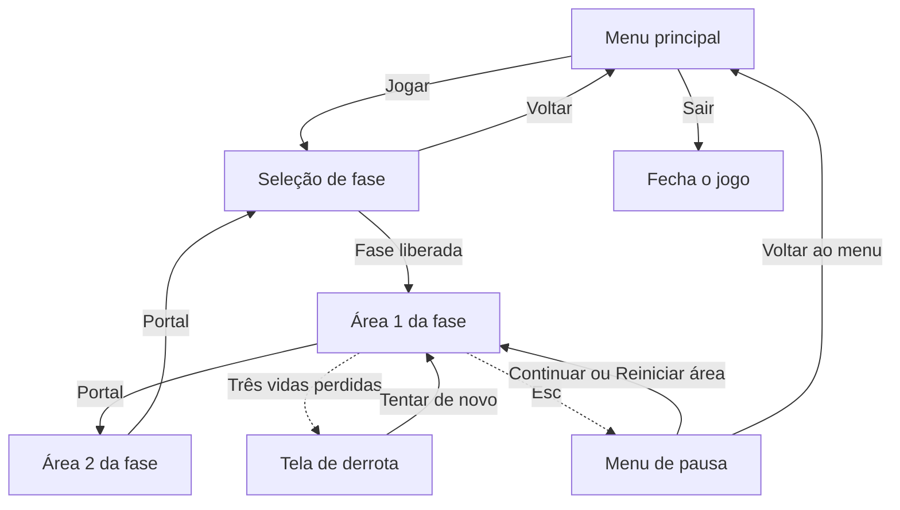

# Documentação — Ascensão ao Olimpo

Tudo o que já está implementado no projeto, sistema por sistema: o que cada script faz, como as cenas são montadas e como usar cada peça para construir as fases.

Situação em 11/10/2026. O [README.md](README.md) explica a organização do repositório e o fluxo de trabalho; o [CHECK.md](CHECK.md) lista as tarefas e a ordem delas. Este arquivo explica o código. A pasta do grupo no Google Drive, onde ficam os arquivos de trabalho, está descrita na seção 12 do README.

## Sumário

1. [O que já existe](#1-o-que-já-existe)
2. [Como rodar e testar](#2-como-rodar-e-testar)
3. [Fluxo do jogo](#3-fluxo-do-jogo)
4. [Configuração do projeto](#4-configuração-do-projeto)
5. [Mapa dos arquivos](#5-mapa-dos-arquivos)
6. [Personagem](#6-personagem)
7. [Dano e vida](#7-dano-e-vida)
8. [Checkpoint, queda e reaparecimento](#8-checkpoint-queda-e-reaparecimento)
9. [Interação com objetos](#9-interação-com-objetos)
10. [Áreas e câmera](#10-áreas-e-câmera)
11. [Portal e conclusão de área](#11-portal-e-conclusão-de-área)
12. [Progresso e salvamento](#12-progresso-e-salvamento)
13. [Transição entre cenas](#13-transição-entre-cenas)
14. [Interface](#14-interface)
15. [Áreas de teste](#15-áreas-de-teste)
16. [Como fazer](#16-como-fazer)
17. [Decisões provisórias](#17-decisões-provisórias)
18. [O que ainda não existe](#18-o-que-ainda-não-existe)
19. [Plano das mecânicas principais](#19-plano-das-mecânicas-principais)
20. [Tarefas cobertas](#20-tarefas-cobertas)

---

## 1. O que já existe

O jogo já tem um ciclo completo, do menu até a liberação de fases:

- Menu principal e tela de seleção de fase.
- Personagem que anda, pula e cai, com câmera que o acompanha.
- Três vidas, dano por contato, invencibilidade temporária e HUD das vidas.
- Checkpoint, queda no buraco e reaparecimento.
- Interação com objetos, e o espelho da fase de Afrodite, que troca de orientação ao ser acionado.
- Tela de derrota e menu de pausa, com saída para o menu principal.
- Portal que conclui a área e leva à próxima cena, com escurecimento da tela.
- Progresso com liberação de fases, gravado em arquivo.
- Duas áreas de teste, que por enquanto fazem o papel da fase 1.

Ainda não há arte nem som. Tudo o que aparece na tela é feito de retângulos coloridos (`ColorRect`), que serão trocados pelos sprites quando a arte chegar. As colisões já estão nos tamanhos que o código usa.

## 2. Como rodar e testar

- **F5** roda o jogo a partir do menu principal.
- **F6** roda a cena aberta no editor. Serve para testar uma área direto, sem passar pelo menu.

Controles que já funcionam:

| Ação | Teclado | Controle |
|---|---|---|
| Andar | A e D, ou setas para os lados | Direcional ou analógico esquerdo |
| Pular | Espaço, W ou seta para cima | A |
| Interagir | E | Y |
| Pausar | Esc | Start |
| Navegar nos menus | Setas e Enter | Direcional e A |

As ações `atacar` (J) e `esquivar` (K ou Shift) já estão cadastradas no projeto, mas nenhum script as usa ainda.

## 3. Fluxo do jogo



- Toda troca ou recarga de cena passa pela `Transicao`, que escurece e clareia a tela.
- Atravessar o portal registra a área como concluída. Com as duas áreas de uma fase concluídas, a fase seguinte é liberada.
- O portal da segunda área leva de volta à seleção de fase. É lá que a fase recém-liberada aparece.
- Em qualquer área, Esc abre o menu de pausa. A derrota e a pausa valem para as duas áreas, não só para a primeira, como o diagrama mostra por simplicidade.

## 4. Configuração do projeto

| Item | Valor |
|---|---|
| Versão da engine | Godot 4.7.2, versão padrão (sem .NET) |
| Renderizador | Compatibilidade |
| Resolução base | 1280×720, com esticamento no modo `canvas_items` |
| Cena principal | `res://cenas/ui/menu_principal.tscn` |
| Autoloads | `Transicao` e `Progresso` |
| Grupo | `jogador`, onde está o personagem |

**Autoloads** são scripts que ficam carregados o jogo inteiro, fora das cenas, e podem ser chamados de qualquer lugar pelo nome. Ficam cadastrados em Projeto > Configurações do Projeto > Globais.

**Camadas de física.** Cada objeto diz em que camada está (`collision_layer`) e quais camadas ele enxerga (`collision_mask`).

| Camada | Nome | Quem está nela hoje | Valor no arquivo |
|---|---|---|---|
| 1 | mundo | Chão, plataformas e paredes | 1 |
| 2 | jogador | Corpo e hurtbox do personagem | 2 |
| 3 | inimigos | Ninguém ainda | 4 |
| 4 | perigos | Espinhos e zona de queda | 8 |
| 5 | interativos | Checkpoint e portal | 16 |

Perigos e interativos têm máscara 2: só enxergam o personagem. O personagem tem máscara 1: só colide com o mundo.

## 5. Mapa dos arquivos

| Script | Cena | O que é |
|---|---|---|
| `scripts/jogador/jogador.gd` | `cenas/jogador/jogador.tscn` | Personagem principal |
| `scripts/sistemas/hitbox.gd` | usada em `cenas/objetos/espinhos.tscn` | Região que causa dano |
| `scripts/sistemas/hurtbox.gd` | usada dentro do jogador | Região que recebe dano |
| `scripts/sistemas/vida.gd` | usada dentro do jogador | Pontos de vida e invencibilidade |
| `scripts/sistemas/interativo.gd` | usada dentro do espelho | Marca um objeto como acionável |
| `scripts/jogador/interacao_do_jogador.gd` | nó `Interacao` do jogador | Escolhe e aciona o objeto mais próximo |
| `scripts/fases/fase_1_afrodite/espelho.gd` | `cenas/fases/fase_1_afrodite/elementos/espelho.tscn` | Espelho do puzzle de Afrodite |
| `scripts/sistemas/transicao.gd` | autoload, sem cena | Escurecimento nas trocas de cena |
| `scripts/sistemas/progresso.gd` | autoload, sem cena | Fases liberadas e salvamento |
| `scripts/fases/area_de_jogo.gd` | raiz de cada área | Fase, área e limites da câmera |
| `scripts/objetos/checkpoint.gd` | `cenas/objetos/checkpoint.tscn` | Ponto de retorno |
| `scripts/objetos/zona_de_queda.gd` | nó dentro da área | Buraco abaixo do cenário |
| `scripts/objetos/portal.gd` | `cenas/objetos/portal.tscn` | Saída da área |
| `scripts/ui/hud.gd` | `cenas/ui/hud.tscn` | Vidas na tela |
| `scripts/ui/tela_de_derrota.gd` | `cenas/ui/tela_de_derrota.tscn` | Tela de derrota |
| `scripts/ui/menu_de_pausa.gd` | `cenas/ui/menu_de_pausa.tscn` | Menu de pausa |
| `scripts/ui/menu_principal.gd` | `cenas/ui/menu_principal.tscn` | Menu principal |
| `scripts/ui/selecao_de_fase.gd` | `cenas/ui/selecao_de_fase.tscn` | Seleção de fase |

As áreas de teste ficam em `cenas/fases/teste/`. Cada fase definitiva tem a sua pasta em `cenas/fases/`, com uma subpasta `elementos/` para as cenas que só ela usa, e uma pasta de mesmo nome em `scripts/fases/` para os scripts desses elementos. Por enquanto só a de Afrodite tem conteúdo: o espelho. As regras completas estão na seção 4 do README.

Cada script tem um `class_name` igual ao nome do arquivo em maiúsculas iniciais (`Jogador`, `Vida`, `Portal` e assim por diante), que é o que permite escrever `if corpo is Jogador`.

## 6. Personagem

**Arquivos:** `scripts/jogador/jogador.gd` e `cenas/jogador/jogador.tscn`.

```
Jogador (CharacterBody2D, camada 2, grupo "jogador")
├── Visual (Node2D)          vira para o lado em que o personagem olha
│   ├── Corpo (ColorRect)    retângulo dourado de 32×64
│   └── Frente (ColorRect)   marca escura que mostra para onde ele olha
├── Colisao (CollisionShape2D)   retângulo de 32×64
├── Camera (Camera2D)        suavização de posição ligada, velocidade 8
├── Hurtbox (Area2D)         retângulo de 28×60, onde ele pode ser atingido
├── Vida (Node)              três vidas
└── Interacao (Node2D)       no meio do corpo; escolhe e aciona objetos (seção 9)
```

A origem do personagem fica nos pés. Para posicionar, basta pôr o `y` do personagem igual ao `y` do topo do chão.

**Movimento.** O personagem acelera até a velocidade máxima e freia com atrito ao soltar a direção. No ar, o controle horizontal é menor. A gravidade é maior na queda do que na subida, para o pulo não parecer flutuante.

**Salto.** Três ajustes deixam o pulo mais fácil de usar:

- **Salto variável:** soltar o botão no meio da subida corta o pulo, o que permite pulos curtos.
- **Tempo coyote:** ainda dá para pular por um instante depois de sair de uma borda.
- **Buffer do salto:** apertar o pulo um pouco antes de tocar o chão já conta.

**Valores ajustáveis no Inspetor:**

| Propriedade | Valor | O que controla |
|---|---|---|
| `velocidade_maxima` | 320 | Velocidade horizontal, em pixels por segundo |
| `aceleracao` | 2200 | Quão rápido ganha velocidade no chão |
| `atrito` | 2600 | Quão rápido para ao soltar a direção |
| `aceleracao_no_ar` | 1400 | Controle horizontal no ar |
| `velocidade_do_salto` | 680 | Força do pulo. Com os valores atuais, o pulo sobe cerca de 136 pixels |
| `gravidade` | 1700 | Gravidade na subida |
| `gravidade_na_queda` | 2400 | Gravidade na queda |
| `velocidade_maxima_de_queda` | 1100 | Limite da velocidade de queda |
| `corte_do_salto` | 0,45 | Fração da velocidade mantida ao soltar o botão |
| `tempo_coyote` | 0,1 s | Tolerância depois de sair da borda |
| `tempo_buffer_do_salto` | 0,12 s | Tolerância antes de tocar o chão |

**Sinais e funções para outros scripts:**

| Nome | Tipo | Para que serve |
|---|---|---|
| `aterrissou` | sinal | Emitido quando o personagem toca o chão depois de estar no ar |
| `pulou` | sinal | Emitido quando o personagem sai do chão por um salto |
| `olhando_para` | variável | 1 se olha para a direita, -1 para a esquerda |
| `ponto_de_retorno` | variável | Onde ele reaparece. Começa na posição inicial |
| `definir_ponto_de_retorno(posicao)` | função | Usada pelo checkpoint |
| `cair()` | função | Usada pela zona de queda: perde uma vida, mesmo invencível, e reaparece |
| `reaparecer()` | função | Leva o personagem ao ponto de retorno |

Os sinais `aterrissou` e `pulou` ainda não têm ninguém escutando. Eles existem para as animações e os efeitos sonoros se ligarem depois.

## 7. Dano e vida

**Arquivos:** `scripts/sistemas/hitbox.gd`, `hurtbox.gd` e `vida.gd`.

O dano é dividido em três peças que servem para qualquer coisa do jogo: personagem, inimigos, chefes e armadilhas.

| Peça | Tipo de nó | Papel |
|---|---|---|
| `Hitbox` | Area2D | Região que causa dano. Fica em quem ataca |
| `Hurtbox` | Area2D | Região que pode ser atingida. Fica em quem apanha |
| `Vida` | Node | Guarda os pontos de vida e decide se o golpe conta |

**Como um golpe acontece:**

1. A cada quadro de física, a `Hitbox` chama `receber_golpe` em toda `Hurtbox` encostada nela.
2. A `Hurtbox` emite o sinal `atingida`.
3. A `Vida` ligada àquela hurtbox recebe o sinal e chama `receber_dano`.
4. Se o dono não estiver invencível nem morto, a vida diminui e começa a invencibilidade.

A hitbox golpeia o tempo todo, e é a `Vida` que ignora os golpes repetidos. Assim, quem fica parado em cima dos espinhos leva um dano a cada segundo, e não um por quadro.

**Hitbox**

| Propriedade | Valor | O que controla |
|---|---|---|
| `dano` | 1 | Quanto de vida cada golpe tira |
| `ativa` | ligada | Desligue para a hitbox parar de causar dano sem sair da cena |

**Vida**

| Nome | Tipo | Para que serve |
|---|---|---|
| `vida_maxima` | propriedade, 3 | Vida cheia |
| `tempo_de_invencibilidade` | propriedade, 1 s | Tempo sem levar outro golpe depois de um dano |
| `hurtbox` | propriedade | De qual hurtbox vêm os golpes |
| `visual` | propriedade, opcional | Nó que pisca durante a invencibilidade |
| `vida_atual` | variável | Vida no momento |
| `vida_mudou(atual, maxima)` | sinal | Emitido a cada mudança. É o que o HUD escuta |
| `sofreu_dano(quantidade)` | sinal | Emitido quando um golpe tira vida |
| `morreu` | sinal | Emitido uma única vez, quando a vida chega a zero |
| `receber_dano(quantidade, ignorar_invencibilidade)` | função | Tira vida. Respeita a invencibilidade, a não ser que o segundo valor venha verdadeiro, como na queda |
| `restaurar()` | função | Volta à vida cheia |
| `esta_invencivel()`, `esta_morto()` | funções | Consultas |

**Espinhos** (`cenas/objetos/espinhos.tscn`) são o primeiro uso: uma `Hitbox` de 100×24 na camada de perigos, com dano 1. Não têm script próprio.

## 8. Checkpoint, queda e reaparecimento

**Arquivos:** `scripts/objetos/checkpoint.gd`, `zona_de_queda.gd` e as funções `cair` e `reaparecer` do jogador.

**Checkpoint** (`cenas/objetos/checkpoint.tscn`). Quando o personagem passa por ele, o checkpoint muda de cinza para verde e vira o ponto de retorno. Cada checkpoint ativa uma vez só e emite o sinal `ativado`. As cores são ajustáveis (`cor_inativo` e `cor_ativo`).

**Zona de queda.** É uma `Area2D` larga e baixa, posta abaixo do cenário, com o script `zona_de_queda.gd`. Quando o personagem entra nela, ela chama `cair()`.

**O que acontece em cada caso:**

| Situação | Resultado |
|---|---|
| Encostar nos espinhos | Perde uma vida, pisca por 1 s e continua onde está |
| Cair no buraco | Perde uma vida e volta ao último checkpoint |
| Cair no buraco sem checkpoint ativado | Perde uma vida e volta à posição inicial da área |
| Cair no buraco durante a invencibilidade | Perde uma vida do mesmo jeito e volta ao checkpoint |
| Cair no buraco com uma vida só | Abre a tela de derrota, sem reaparecer |
| Perder a terceira vida nos espinhos | Abre a tela de derrota |

A invencibilidade protege de golpes, não de buraco. Cada queda conta uma vez, mesmo que duas zonas de queda estejam encostadas. Depois de reaparecer, o personagem fica 1 s sem levar golpes.

O checkpoint não devolve vida. As vidas voltam ao máximo quando a cena é recarregada ou trocada, porque o personagem é criado de novo junto com a cena.

## 9. Interação com objetos

**Arquivos:** `scripts/sistemas/interativo.gd`, `scripts/jogador/interacao_do_jogador.gd` e, como primeiro objeto, `scripts/fases/fase_1_afrodite/espelho.gd`.

**Situação:** implementado e coberto por testes automáticos. Falta o teste manual no editor.

A interação tem duas peças:

| Peça | Onde fica | Papel |
|---|---|---|
| `Interativo` | Filho do objeto | Marca o objeto como acionável e avisa quando foi acionado |
| `InteracaoDoJogador` | Nó `Interacao` do personagem | Escolhe o objeto mais próximo e o aciona ao apertar o botão |

**Regras:**

- Só é possível interagir com um objeto que esteja dentro do alcance dele. A distância é medida entre o nó `Interativo` e o meio do corpo do personagem.
- Com mais de um objeto ao alcance, vale o mais próximo.
- No empate, ou quase empate, o objeto atual continua selecionado. Para trocar, o outro precisa estar mais perto por mais de 4 pixels (`margem_de_troca`).
- Só o objeto selecionado mostra o destaque e a tecla.
- Cada aperto do botão aciona uma vez. Segurar não repete.
- Não há interação com o jogo pausado (pausa e derrota) nem durante uma transição, incluindo o clareamento da tela.
- Não há inventário: o efeito acontece na hora.

**Interativo**

| Nome | Tipo | Para que serve |
|---|---|---|
| `alcance` | propriedade, 72 | Distância máxima até o personagem, em pixels |
| `habilitado` | propriedade | Desligue para o objeto deixar de aceitar interação |
| `destaque` | propriedade, opcional | Nó mostrado só enquanto o objeto está selecionado |
| `dica` | propriedade, opcional | Nó com a indicação do comando, mostrado só na seleção |
| `acionado(jogador)` | sinal | Emitido a cada interação. É o que o objeto escuta |
| `selecao_mudou(selecionado)` | sinal | Emitido quando o objeto ganha ou perde a seleção |
| `selecionado` | variável | Verdadeiro enquanto é o objeto que será acionado |

Todo `Interativo` entra sozinho no grupo `interativos`. É por esse grupo que o personagem encontra os objetos da cena.

**InteracaoDoJogador**

| Nome | Tipo | Para que serve |
|---|---|---|
| `habilitada` | propriedade | Desligue para o personagem deixar de interagir por um tempo. A esquiva vai usar isso |
| `margem_de_troca` | propriedade, 4 | Diferença mínima de distância para trocar de objeto |
| `selecionado` | variável | Objeto que será acionado, ou nulo |
| `selecao_mudou(objeto)` | sinal | Emitido quando o objeto selecionado muda |
| `interagiu(objeto)` | sinal | Emitido quando o personagem aciona um objeto |

**Espelho** (`cenas/fases/fase_1_afrodite/elementos/espelho.tscn`). É a primeira peça do puzzle de luz de Afrodite. Tem duas orientações, `/` e `\`, e troca de uma para a outra a cada interação.

```
Espelho (Node2D)             origem no centro do espelho
├── Destaque (ColorRect)     moldura branca, visível só na seleção
├── Moldura (ColorRect)      quadrado escuro de 48×48
├── Face (Line2D)            linha diagonal que mostra a orientação
├── Dica (Label)             letra "E", visível só na seleção
└── Interativo (Node2D)      alcance de 80
```

| Nome | Tipo | Para que serve |
|---|---|---|
| `orientacao_inicial` | propriedade | Orientação com que o espelho começa a área: `BARRA` (`/`) ou `CONTRABARRA` (`\`) |
| `orientacao` | variável | Orientação atual. É este valor que o cálculo da luz vai ler |
| `alternar()` | função | Troca `/` por `\` e vice-versa |
| `definir_orientacao(nova)` | função | Põe uma orientação específica |
| `orientacao_mudou(orientacao)` | sinal | Emitido a cada mudança |

A orientação é um valor guardado no script, e não a rotação do desenho. O desenho é provisório: uma linha diagonal dentro de um quadrado. Quando a arte chegar, cada orientação ganha a sua imagem, sem mexer na lógica.

Por enquanto o espelho só muda de orientação. Ainda não existem a fonte de luz, o feixe nem o receptor.

## 10. Áreas e câmera

**Arquivo:** `scripts/fases/area_de_jogo.gd`.

Toda área jogável tem na raiz um `Node2D` com o script `AreaDeJogo`. Ele guarda três informações:

| Propriedade | Valores | Para que serve |
|---|---|---|
| `fase` | 0 a 5 | Fase a que a área pertence. 0 significa fora das fases |
| `area` | 0 a 2 | Número da área dentro da fase. 0 significa fora das fases |
| `limites_da_camera` | retângulo em pixels | Canto superior esquerdo e tamanho da área |

Ao carregar, a área passa os limites para a câmera do personagem, que deixa de mostrar o que está fora do cenário, e enquadra a câmera na hora, sem deslizar. O padrão é `(0, 0, 2560, 720)`: uma área de duas telas de largura.

`fase` e `area` são o que o portal usa para registrar a conclusão. Uma área com `fase = 0` nunca conta para o progresso, o que serve para cenas de experimento.

## 11. Portal e conclusão de área

**Arquivos:** `scripts/objetos/portal.gd` e `cenas/objetos/portal.tscn`.

O portal é a saída da área: um retângulo roxo de 48×96. Quando o personagem entra:

1. Emite o sinal `atravessado`.
2. Lê `fase` e `area` na raiz da cena e chama `Progresso.concluir_area`.
3. Chama `Transicao.trocar_cena` com o caminho posto em `proxima_cena`.

O portal da última área de uma fase deve apontar para `res://cenas/ui/selecao_de_fase.tscn`, como já faz o da segunda área de teste.

Cada portal funciona uma vez só. Com `proxima_cena` vazio, ele registra a conclusão e avisa no console que não há próxima cena.

## 12. Progresso e salvamento

**Arquivo:** `scripts/sistemas/progresso.gd`, autoload `Progresso`.

**Regras:**

- O jogo tem 5 fases, cada uma com 2 áreas.
- A fase 1 começa liberada.
- Concluir as duas áreas de uma fase libera a fase seguinte.
- Concluir de novo uma área já concluída não muda nada.
- Áreas de fases ainda bloqueadas e áreas com fase 0 são ignoradas.

**Funções e sinais:**

| Nome | Tipo | Para que serve |
|---|---|---|
| `fase_esta_liberada(fase)` | função | Diz se dá para entrar na fase |
| `area_esta_concluida(fase, area)` | função | Diz se a área já foi concluída |
| `fase_esta_concluida(fase)` | função | Diz se as duas áreas da fase foram concluídas |
| `jogo_esta_concluido()` | função | Diz se a fase 5 foi concluída |
| `concluir_area(fase, area)` | função | Registra a conclusão. É o que o portal chama |
| `reiniciar()` | função | Apaga todo o progresso |
| `salvar()`, `carregar()` | funções | Gravam e leem o arquivo. Rodam sozinhas |
| `mudou` | sinal | Emitido a cada mudança no progresso |
| `fase_foi_liberada(fase)` | sinal | Emitido quando uma fase nova é liberada |

**Salvamento.** O progresso é gravado a cada mudança e lido quando o jogo abre. Não existe botão de salvar. O arquivo é `user://progresso.json`, na pasta de dados do jogo no computador de quem joga. Para chegar nela: Projeto > Abrir Pasta de Dados do Usuário.

```json
{
	"versao": 1,
	"fases_liberadas": 2,
	"areas_concluidas": ["1-1", "1-2"]
}
```

Cada área concluída aparece como `"fase-area"`. Na leitura, nada do arquivo é usado sem conferência: números fora da faixa são corrigidos, áreas inexistentes são descartadas, e um arquivo ilegível faz o jogo começar do zero com um aviso no console, em vez de dar erro.

## 13. Transição entre cenas

**Arquivo:** `scripts/sistemas/transicao.gd`, autoload `Transicao`.

| Função | O que faz |
|---|---|
| `Transicao.trocar_cena(caminho)` | Escurece, carrega a cena do caminho e clareia |
| `Transicao.recarregar_cena()` | Escurece, recarrega a cena atual e clareia |
| `Transicao.em_andamento()` | Diz se há uma transição acontecendo, do começo do escurecimento ao fim do clareamento |

Cada metade, escurecer e clarear, dura 0,25 s. Durante o escurecimento o jogo fica pausado e os cliques ficam bloqueados. Uma segunda chamada feita no meio de uma transição é ignorada. Se o caminho não existir, o erro aparece no console e o jogo continua na cena em que estava.

Quem usa hoje: os botões do menu principal e da seleção de fase, o portal, o "Tentar de novo" da derrota e o "Reiniciar área" e o "Voltar ao menu" da pausa.

Toda troca de cena nova deve usar a `Transicao`, e não `change_scene_to_file` direto.

## 14. Interface

Todas as telas seguem a mesma montagem: um `Control` do tamanho da tela, um `Fundo` (`ColorRect`), um `Centro` (`CenterContainer`) e dentro dele uma `Caixa` (`VBoxContainer`) com o título e os botões. Os botões recebem foco ao abrir, então dá para usar setas e Enter ou o controle.

**HUD** (`cenas/ui/hud.tscn`). É um `CanvasLayer`, que fica fixo na tela enquanto a câmera se move. Mostra um quadrado por vida no canto superior esquerdo: vermelho para vida cheia, cinza para vida perdida. Ele encontra o personagem pelo grupo `jogador` e escuta o sinal `vida_mudou`. A tela de derrota e o menu de pausa são filhos do HUD, então uma área que tem o HUD já tem os dois.

**Tela de derrota** (`cenas/ui/tela_de_derrota.tscn`). Aparece quando a `Vida` do personagem emite `morreu`. Pausa o jogo e mostra "Você perdeu" com o botão **Tentar de novo**, que escurece a tela e recarrega a área: vidas cheias e checkpoints desativados.

**Menu de pausa** (`cenas/ui/menu_de_pausa.tscn`). Abre e fecha com a ação `pausar`. Tem três botões:

| Botão | O que faz |
|---|---|
| **Continuar** | Fecha o menu e volta ao jogo |
| **Reiniciar área** | Escurece a tela e recarrega a área |
| **Voltar ao menu** | Escurece a tela e abre o menu principal |

A cena aberta pelo Voltar ao menu é a propriedade `cena_do_menu`. Sair pela pausa não pede confirmação e perde o que foi feito na área, mas não mexe no progresso salvo. Depois que Reiniciar ou Voltar ao menu é escolhido, o menu deixa de responder até a cena ser trocada. A tecla de pausa não faz nada enquanto a tela de derrota está aberta nem durante uma transição.

A derrota e a pausa funcionam com o jogo pausado porque as duas cenas estão no modo de processamento "Sempre" (`process_mode = 3`).

**Menu principal** (`cenas/ui/menu_principal.tscn`). É a cena principal do jogo. Tem o título e os botões **Jogar**, que abre a seleção de fase, e **Sair**, que fecha o jogo. A cena aberta pelo Jogar é a propriedade `cena_ao_jogar`.

**Seleção de fase** (`cenas/ui/selecao_de_fase.tscn`). Tem um botão por fase e o botão **Voltar**. Cada botão fica em um de três estados:

| Estado | Aparência | Quando |
|---|---|---|
| Disponível | Aceso | Fase liberada e com cena cadastrada |
| Em construção | Apagado, com "(em construção)" | Fase liberada, mas ainda sem cena |
| Bloqueada | Apagado, com "(bloqueada)" | Fase ainda não liberada |

Os nomes das fases são o texto dos botões `Fase1` a `Fase5` na cena, e podem ser trocados pelo editor. A cena de entrada de cada fase fica na propriedade `cenas_das_fases`, uma lista com cinco caminhos. Hoje só o primeiro está preenchido, com a primeira área de teste.

## 15. Áreas de teste

Ficam em `cenas/fases/teste/` e servem para experimentar os sistemas. Por enquanto estão marcadas como fase 1, áreas 1 e 2, para o progresso poder ser testado.

**`area_teste.tscn`**, com 2560 pixels de largura (duas telas):

| O quê | Onde |
|---|---|
| Personagem | Começa em x = 200 |
| Dois espelhos | Em x = 260 e 340, acima da cabeça do personagem. O primeiro começa em `/` e o segundo em `\` |
| Três plataformas | Em x = 500, 820 e 1200 |
| Espinhos | Em x = 1000, no chão |
| Checkpoint | Em x = 1500 |
| Buraco | Entre x = 1700 e 1860, com a zona de queda embaixo |
| Portal | Em x = 2460, leva à área 2 |

**`area_teste_2.tscn`**, com 1280 pixels de largura (uma tela): chão, uma plataforma e um portal em x = 1160 que leva à seleção de fase.

## 16. Como fazer

**Criar uma área nova**

1. Crie uma cena com um `Node2D` na raiz e ponha nele o script `area_de_jogo.gd`.
2. No Inspetor, preencha `Fase`, `Area` e `Limites Da Camera` com o tamanho da área.
3. Monte o chão e as plataformas com `StaticBody2D` na camada 1.
4. Instancie `cenas/jogador/jogador.tscn` e ponha o personagem com os pés no chão.
5. Instancie `cenas/ui/hud.tscn`. Com ele vêm a tela de derrota e o menu de pausa.
6. Instancie `cenas/objetos/portal.tscn` no fim da área e preencha `Proxima Cena`: na área 1, com a área 2 da mesma fase; na área 2, com `res://cenas/ui/selecao_de_fase.tscn`.
7. Se a área tiver buracos, ponha embaixo dela uma `Area2D` com o script `zona_de_queda.gd`, na camada 4 e com máscara 2.
8. Salve na pasta da fase, em `cenas/fases/`, como `area_1.tscn` ou `area_2.tscn`.

**Criar um elemento que só uma fase usa.** Salve a cena em `cenas/fases/fase_N_nome/elementos/` e o script em `scripts/fases/fase_N_nome/`. Se outra fase passar a usar o mesmo elemento, mova os dois para as pastas comuns (`cenas/objetos/` e `scripts/objetos/`), sempre por dentro da Godot.

**Pôr espinhos ou um checkpoint.** Instancie `cenas/objetos/espinhos.tscn` ou `cenas/objetos/checkpoint.tscn` e posicione com a base no chão. Nenhum dos dois precisa de configuração.

**Ligar uma fase nova à seleção.** Abra `cenas/ui/selecao_de_fase.tscn`, clique na raiz e, em `Cenas Das Fases`, preencha a posição da fase com o caminho da primeira área dela.

**Dar vida a um inimigo ou chefe.** Ponha nele uma `Area2D` com o script `hurtbox.gd` e um `Node` com o script `vida.gd`. No Inspetor da `Vida`, aponte `Hurtbox` para a área e ajuste `Vida Maxima`. Depois, ligue o sinal `morreu` ao que deve acontecer quando ele for derrotado.

**Fazer algo causar dano.** Ponha uma `Area2D` com o script `hitbox.gd`, na camada de quem ataca e com máscara na camada de quem apanha. Para um ataque que só vale por um instante, ligue e desligue a propriedade `ativa`.

**Criar um objeto com que o personagem interage.** Ponha no objeto um `Node2D` com o script `interativo.gd`, no ponto de onde a distância deve ser medida, e ajuste `Alcance`. Se quiser destaque e indicação da tecla, crie esses nós escondidos e aponte `Destaque` e `Dica` para eles. No script do objeto, ligue o sinal `acionado` ao que deve acontecer. O `espelho.gd` é o exemplo a seguir.

**Pôr um espelho em uma área.** Instancie `cenas/fases/fase_1_afrodite/elementos/espelho.tscn`, posicione pelo centro e escolha `Orientacao Inicial` no Inspetor.

**Zerar o progresso para testar.** Apague o arquivo `progresso.json` em Projeto > Abrir Pasta de Dados do Usuário.

## 17. Decisões provisórias

Escolhas feitas para o código andar, que o grupo ainda precisa confirmar:

- **Teclas e nomes das camadas de física.** Os valores estão na seção 4 e no README.
- **Resolução de 1280×720**, até a definição da escala dos sprites.
- **Cada golpe tira uma das três vidas**, e a invencibilidade depois do golpe dura 1 s.
- **Espinhos tiram vida sem teletransportar; o buraco tira vida e leva ao checkpoint.**
- **A queda tira vida mesmo durante a invencibilidade.**
- **O checkpoint não devolve vida.**
- **As vidas voltam ao máximo a cada área**, porque o personagem é criado de novo com a cena.
- **As fases liberam em sequência**, depois das duas áreas da anterior.
- **A ordem das fases** é Afrodite, Ares, Hades, Poseidon e Zeus.
- **A seleção sempre entra pela área 1 da fase.**
- **O fim da fase leva de volta à seleção de fase.**
- **"Voltar ao menu", na pausa, leva ao menu principal** e não pede confirmação.
- **Valores de movimento e de salto**, que foram ajustados no olho.
- **Alcance da interação:** 72 pixels por padrão e 80 no espelho.
- **A luz do puzzle de Afrodite anda só na horizontal e na vertical**, e os espelhos têm duas orientações diagonais.

## 18. O que ainda não existe

- Ataque e esquiva.
- Fonte de luz, feixe e receptor do puzzle de Afrodite. Só o espelho existe.
- Inimigos, chefes e barra de vida de chefe.
- Plataformas móveis, armadilhas, portas, mecanismos e puzzles.
- Tela de vitória, pontuação e contadores.
- Configurações e áudio.
- Arte, animações e sons.
- As dez áreas definitivas.
- Exportação e executável.

Limitações conhecidas do que já existe:

- A tela de derrota só oferece "Tentar de novo". Quem perde não tem como sair para o menu por ali.
- Não há botão para apagar o progresso; só apagando o arquivo.
- A seleção não mostra quais fases já foram concluídas.
- As pastas das fases de Ares, Hades, Poseidon e Zeus existem, mas ainda estão vazias.
- No editor, o espelho aparece sempre como `/`. A orientação inicial escolhida só aparece ao rodar o jogo.
- A indicação do comando mostra sempre a tecla "E", mesmo para quem joga no controle.
- A interação não confere se há parede entre o personagem e o objeto: basta a distância.
- O espelho não tem colisão: o personagem passa na frente dele.

## 19. Plano das mecânicas principais

As mecânicas do herói estão sendo feitas em oito etapas, uma por vez. Esta tabela separa o que já está no jogo do que ainda é plano.

| Etapa | O que entrega | Situação |
|---|---|---|
| 1 | Interação com objetos, com o espelho como objeto de teste, e correção da queda | Implementada. Testes automáticos feitos; falta o teste manual no editor |
| 2 | Puzzle mínimo: fonte de luz, feixe, espelho e receptor | Planejada |
| 3 | Puzzle ligado a um mecanismo e à liberação da saída | Planejada |
| 4 | Quantidade de áreas configurável por fase, com cinco áreas em Afrodite | Planejada |
| 5 | Ataque, validado com um alvo de teste | Planejada |
| 6 | Esquiva, com invulnerabilidade e regras de queda | Planejada |
| 7 | Integração da arte de Afrodite e revisão de escala, câmera e legibilidade | Planejada |
| 8 | Teste do conjunto e documentação final | Planejada |

Decisões já tomadas para as etapas seguintes, ainda não implementadas:

- **Áreas por fase.** O jogo mantém cinco fases. Afrodite terá cinco áreas, e as outras fases terão a quantidade que seus desafios pedirem, sem número fixo. Isso muda o planejamento anterior de dez áreas. Hoje o código ainda considera duas áreas por fase; a mudança é a etapa 4.
- **Saves antigos.** Na etapa 4, as fases já liberadas continuam liberadas, e as áreas novas não são marcadas como concluídas.
- **Luz.** Feixes só na horizontal e na vertical, e espelhos com as orientações `/` e `\`.
- **Ataque.** Golpe corpo a corpo de 0,15 s, dano 1, intervalo de 0,35 s, uma vez por inimigo a cada golpe.
- **Esquiva.** Cerca de 160 pixels em 0,2 s, intervalo de 0,6 s, uma vez no ar até tocar o chão, com imunidade a golpes e perigos, mas não à queda.

Os números são valores iniciais, sujeitos a ajuste durante os testes.

## 20. Tarefas cobertas

Relação entre o que está documentado aqui e os códigos do [CHECK.md](CHECK.md):

| Tarefa | Situação | O que foi feito |
|---|---|---|
| P1 Criar e configurar o projeto na Godot | Concluída | Projeto, resolução e renderizador |
| P3 Organizar cenas, scripts, recursos e pastas | Concluída | Estrutura de pastas do README, com as pastas próprias de cada fase |
| P4 Movimentação, salto, queda e aterrissagem | Concluída | Seção 6 |
| P7 Colisões, hitboxes e hurtboxes | Concluída | Seção 7 |
| P10 Três vidas, checkpoints e reaparecimento | Concluída | Seções 7 e 8 |
| P12 Conclusão de áreas, liberação de fases e reinício | Concluída | Seções 11 e 12 |
| P15 Câmera 2D e limites das áreas | Concluída | Seção 10 |
| P21 Repositório e controle de versões | Concluída | Repositório e fluxo de branches |
| P6 Interação com objetos e animações | Parcial | Sistema de interação e espelho (seção 9); faltam os demais objetos e as animações |
| P2 Resolução, tela e entradas | Parcial | Valores provisórios; falta fechar com as definições |
| P11 Vitória, derrota, pontuação e contadores | Parcial | Tela de derrota |
| P16 Menus, HUD, pausa, configurações, transições e áudio | Parcial | Menu principal, HUD, pausa com saída para o menu e transição |
| P17 Salvamento, seleção de fase, exportação e executável | Parcial | Salvamento e seleção de fase |
| P18 Vida, dano e barra de chefe | Parcial | Vida, dano e invencibilidade |
